<div align="center">

# RubikVision

**Solve a physical 3×3 Rubik's Cube with your webcam.**
Guided scanning with a YOLO26s detector, a validated two-phase solver, and a 3D digital twin that coaches you move by move.


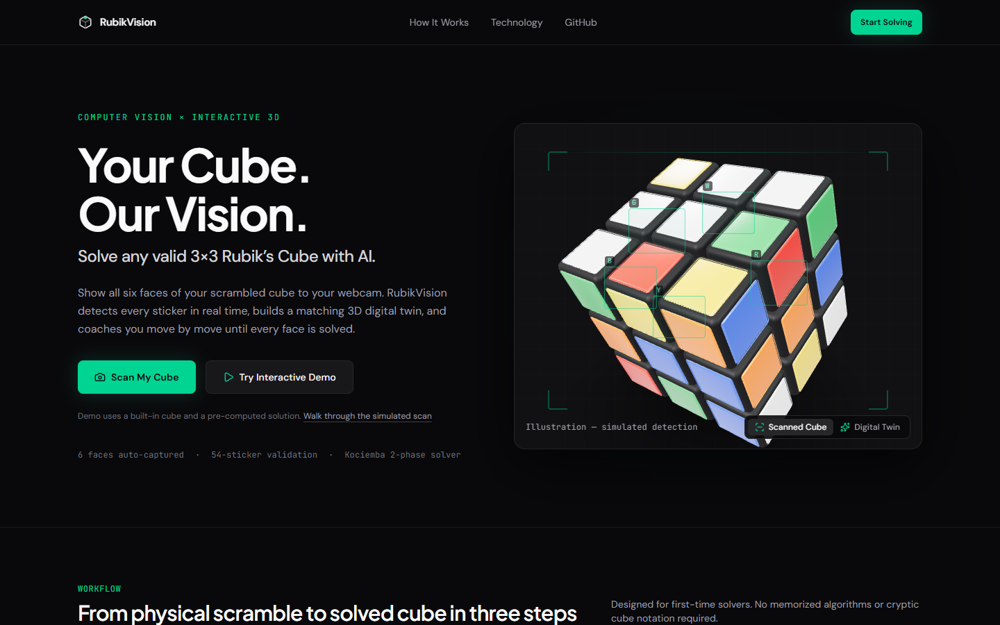

</div>

## Contents

- [How it works](#how-it-works)
- [Features](#features)
- [Screenshots](#screenshots)
- [Quick start](#quick-start)
- [Using the app](#using-the-app)
- [The detection model](#the-detection-model)
- [Training guide](#training-guide)
- [Configuration](#configuration)
- [API](#api)
- [Testing](#testing)
- [Project layout](#project-layout)
- [Privacy and limitations](#privacy-and-limitations)
- [Documentation](#documentation)
- [Licences and credits](#licences-and-credits)

## How it works

```mermaid
flowchart LR
    CAM["Webcam<br/>(browser)"] -->|"square crop, JPEG<br/>one frame in flight"| WS["/ws/scan<br/>FastAPI WebSocket"]
    WS --> YOLO["YOLO26s<br/>6 colour classes"]
    YOLO --> GRID["3×3 lattice fit<br/>cells, face box, quality"]
    GRID -->|"frame_result"| FSM["Scan state machine<br/>stability, gate, capture"]
    FSM -->|"6 faces: F R B L U D"| REC["Reconstruction<br/>54 stickers"]
    REC -->|"POST /api/solve"| SOLVER["Validation + two-phase solver<br/>replayed to solved"]
    SOLVER --> TWIN["3D digital twin<br/>timed move guidance"]
```

- The **backend** owns single-frame geometry (detection, lattice fit, quality) and everything about cube legality and solving.
- The **frontend** owns the scan sequence: stability over several frames, the capture gate, the rotation cue, and the timed guidance.
- A face is captured only after about five consistent results over at least one second. Nine detected stickers never prove the cube is held correctly, so the cube state is always validated again on the server before a solution is shown.

## Features

- **Guided live scan.** A placement zone on the mirrored preview, raw YOLO boxes with confidence labels, a live sticker count with distance coaching, automatic capture (no button), and a clear capture confirmation.
- **Rotation guidance.** An animated arrow between faces plus a large reference cube that repeats the turn and highlights the next face. Return steps are recognised automatically.
- **Strict validation.** Colour counts, six distinct centres, edge and corner legality, orientation sums and permutation parity. Illegal scans are explained and can be rescanned face by face.
- **Verified solution.** A real two-phase solver. Every solution is replayed to solved in two independent engines before guidance is enabled.
- **Timed 3D coach.** Pausable playback with an adjustable pace, a highlighted rotating layer, sound, and a lost-track recovery path.
- **Honest Demo mode.** A clearly labelled scripted flow that never touches the camera or the WebSocket.
- **Safe by default.** Loopback only, no stored frames, explicit origin checks, strict runtime validation of every payload.

## Screenshots

| Live scan (camera off) | Reconstruction (3D twin) |
| :---: | :---: |
| 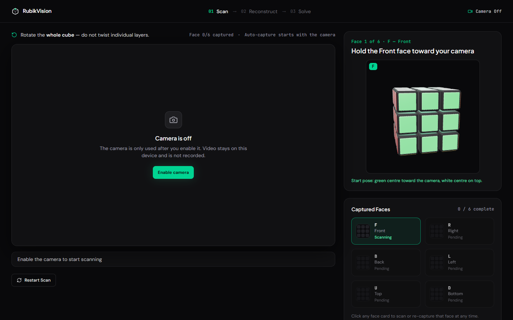 | 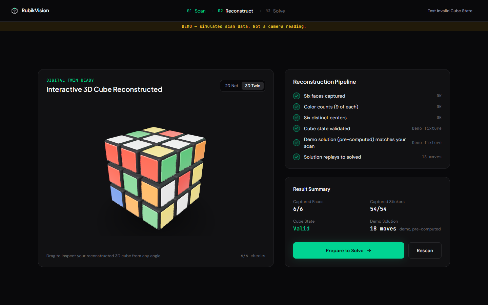 |
| **Reconstruction (2D net)** | **Alignment** |
| 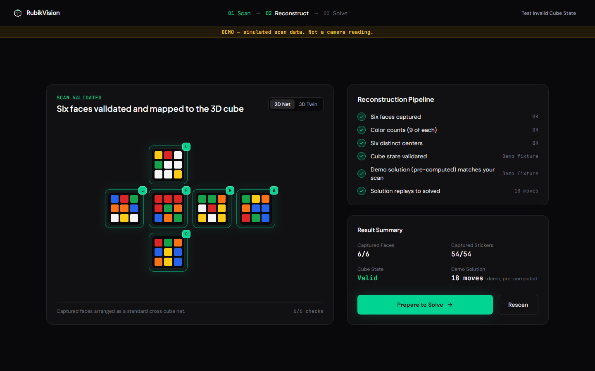 | 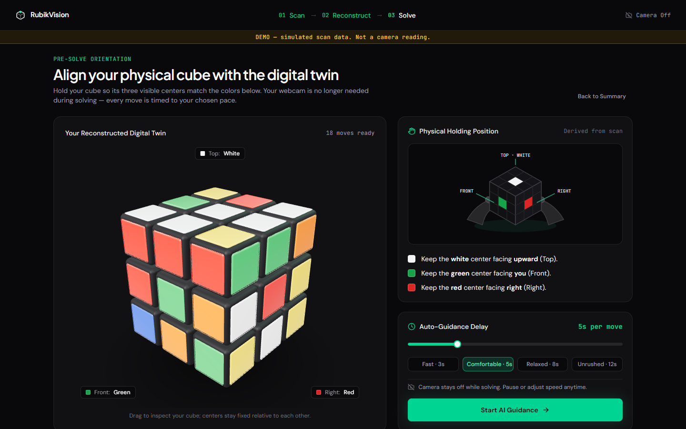 |

<p align="center">
  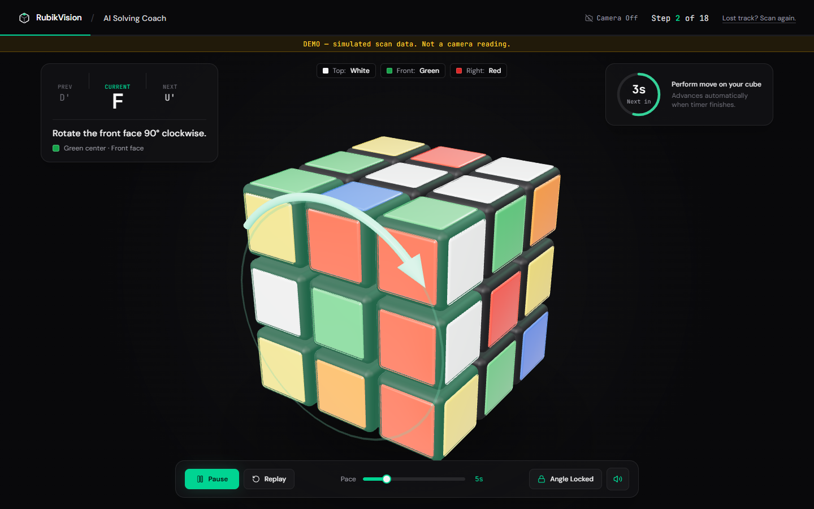<br>
  <sub>Reconstruction, Alignment and Solving shown here come from Demo mode (simulated data, labelled on screen).</sub>
</p>

## Quick start

### Requirements

| Tool | Version |
| --- | --- |
| Node.js | 22 or newer, with npm |
| Python | 3.12 and [uv](https://docs.astral.sh/uv/) |
| Disk / RAM | about 1.6 GB for the solver tables, about 2.3 GB RAM while scanning |
| Webcam | any, 640×480 is enough (only needed for Live mode) |

### 1. Backend

```bash
cd backend
uv sync                                   # install from uv.lock (CPU PyTorch)
uv run python -m app.solver.prepare       # one-time solver table build, about 5-7 min
uv run uvicorn --factory app.main:create_app --host 127.0.0.1 --port 8000
```

The table build writes about 1.6 GB into `backend/.solver-cache/` (git-ignored). The server refuses to start without the tables and prints the command above. `uvicorn --factory app.main:create_app` is the only supported start form.

### 2. Detection weights (Live mode)

Place the trained checkpoint at **`backend/weights/best.pt`**. It is git-ignored and not in this repository. Without it the backend still starts and the solver works; `/health` reports `status: degraded` and Live scanning stays blocked. It never falls back to generic or fixture weights. To produce your own checkpoint, see the [training guide](#training-guide).

### 3. Frontend

```bash
cd frontend
npm ci
npm run dev                               # http://127.0.0.1:5173 (loopback only)
```

The dev server proxies `/api`, `/health` and `/ws` to `127.0.0.1:8000`. Open <http://127.0.0.1:5173> and check <http://127.0.0.1:5173/health>: with the model loaded it shows `"visionReady": true` and the model version.

> **Windows tip.** If Vitest fails with a drive-letter error such as `reading 'config'`, run it from PowerShell in a path whose drive-letter case matches the working directory (for example `D:\...`, not `d:\...`).

## Using the app

1. Click **Scan My Cube** and **Enable camera** (or **Try Interactive Demo** to explore without a camera).
2. Hold the cube with the **green centre toward the camera and the white centre on top**. Keep the face inside the dashed square; it can be any size and anywhere inside it. The preview is mirrored like a selfie, so it moves the same way your hands do.
3. Hold steady until the face is captured automatically. Follow the arrow and the reference cube for the next face. **Rotate the whole cube; never twist a layer.**

   | Step | You see | Arrow | You then see | Captured |
   | :-: | --- | :-: | --- | :-: |
   | 1 | green | → | red | R |
   | 2 | red | → | blue | B |
   | 3 | blue | → | orange | L |
   | 4 | orange | → | green | return step |
   | 5 | green | ↓ | white | U |
   | 6 | white | ↑ | green | return step |
   | 7 | green | ↑ | yellow | D |

4. Review the reconstruction, then **Prepare to Solve**. Align your cube with the digital twin, choose a pace, and follow the highlighted moves. Guidance finishing only means the instructions ended; confirm the result on your own cube.

Scanning checks centre colours, not how the cube is held, so it cannot prove whole-cube orientation or face roll. The server's legality check is the safety net.

## The detection model

| | |
| --- | --- |
| Architecture | YOLO26s (Ultralytics 8.4.216), 9.47 M parameters, 20.8 GFLOPs |
| Task | Object detection, six classes: `blue`, `green`, `orange`, `red`, `white`, `yellow` |
| Input | 640 px; the app sends a square crop of the placement zone |
| Checkpoint in use | `yolo26s_rubik_v2`, SHA-256 starts with `1907cc58d790` |
| Runtime | CPU PyTorch 2.14.1, loaded once at startup, classes mapped by **name** (never by ID) |

### Dataset

[`rubik-2mkm7` v3](https://universe.roboflow.com/quang-phuc-ngo/rubik-2mkm7) on Roboflow Universe (CC BY 4.0): **2,895 images**, six sticker colours.

| Split | Images | Instances |
| --- | ---: | ---: |
| Train | 2,375 | 35,857 |
| Validation | 339 | 4,949 |
| Test | 181 | 2,823 |

Images were stretched to 640×640 during preprocessing. The set mixes images from several public sources with a smaller share of webcam frames.

### Results (run `yolo26s_rubik_v2`)

Trained on a Colab T4 for 94 of 150 epochs (early stopping with patience 30; best epoch 64; 1.4 hours). Ultralytics 8.4.216, torch 2.14.1.

| Split | Precision | Recall | mAP50 | mAP50-95 |
| --- | ---: | ---: | ---: | ---: |
| Validation | 0.970 | 0.965 | **0.978** | **0.754** |
| Test | 0.974 | 0.965 | **0.984** | **0.761** |

Per-class results on the **test** split:

| Class | Precision | Recall | mAP50 | mAP50-95 |
| --- | ---: | ---: | ---: | ---: |
| blue | 0.976 | 0.978 | 0.988 | 0.759 |
| green | 0.945 | 0.959 | 0.978 | 0.756 |
| orange | 0.989 | 0.963 | 0.990 | 0.763 |
| red | 0.983 | 0.972 | 0.988 | 0.763 |
| white | 0.987 | 0.945 | 0.983 | 0.763 |
| yellow | 0.963 | 0.976 | 0.976 | 0.761 |

Inference speed measured by Ultralytics on the T4: about 11 ms per image on the test split (plus pre/post-processing). On the CPU of the development machine (Intel i3-9100F) a 640 px frame takes about 190 ms at the median.

<p align="center">
  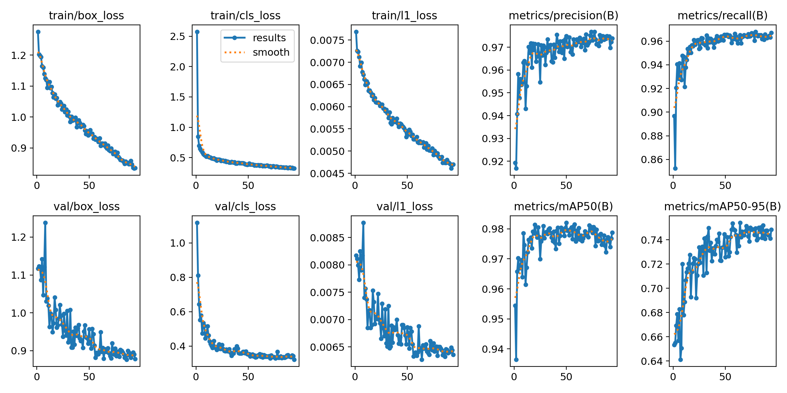<br>
  <sub>Training and validation curves over 94 epochs (<code>results.csv</code>).</sub>
</p>

<table>
  <tr>
    <td align="center">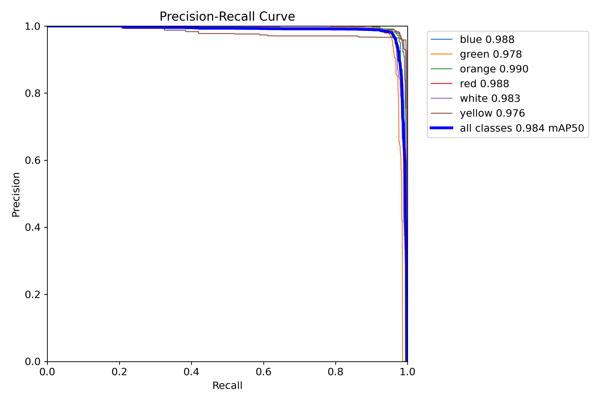<br><sub>Precision-recall curve (test)</sub></td>
    <td align="center">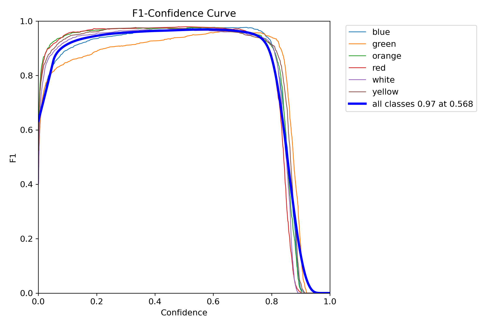<br><sub>F1 versus confidence (test)</sub></td>
  </tr>
  <tr>
    <td align="center">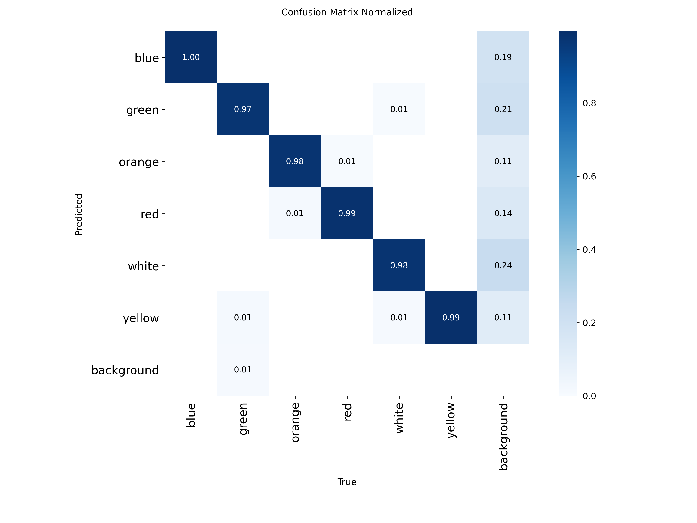<br><sub>Normalised confusion matrix (test)</sub></td>
    <td align="center">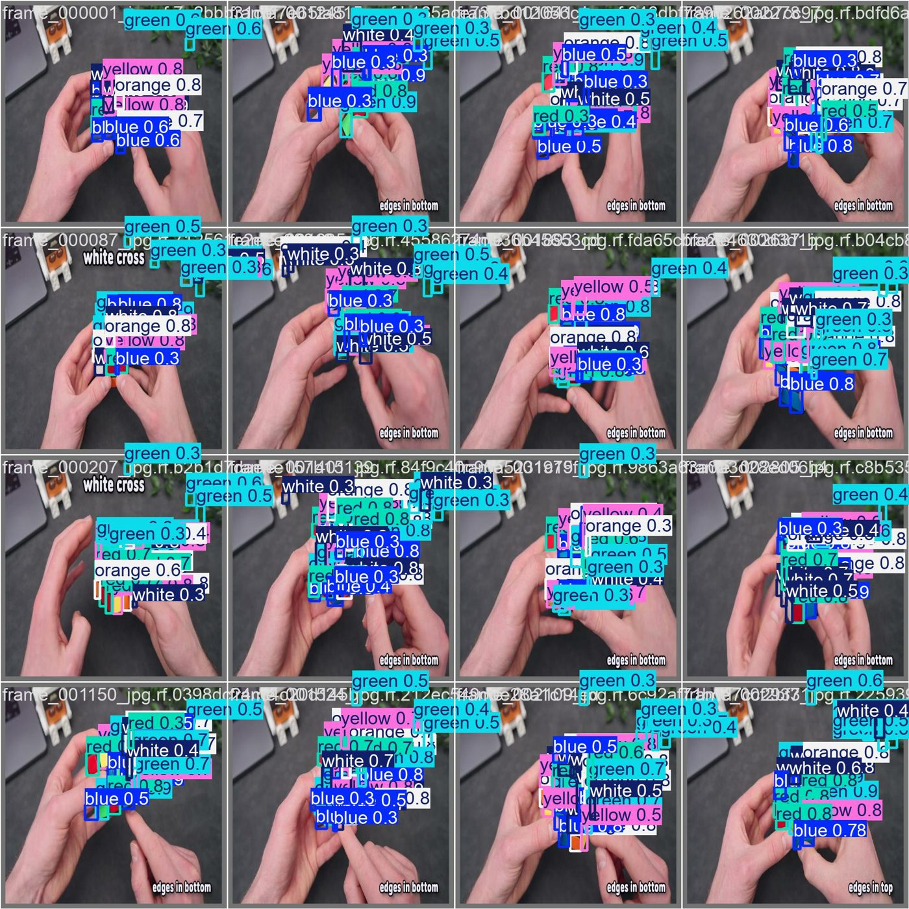<br><sub>Sample predictions (test)</sub></td>
  </tr>
</table>

### How to read these numbers

- **They are dataset metrics, not webcam accuracy.** The splits share sources and augmented copies of the same photos, and only a small part of the data comes from the webcam used with this app. A few source images appear in more than one split, so the test score is optimistic. Real-camera behaviour must be measured separately; that is what the [physical test](docs/superpowers/reports/phase3-physical-test-checklist.md) is for.
- The remaining errors are small colour confusions (red versus orange about 1 %) and **background false positives**: the background column of the confusion matrix shows which colour classes the false detections are assigned to, mostly white, green and blue. The app guards against these at runtime (confidence floor, ambiguity rule, lattice fit), not by model changes.
- Each detection is checked by the app: a sticker whose runner-up colour scores at least 0.6 times the best is marked ambiguous and never used to capture a face.

## Training guide

The model was trained in Google Colab (T4 GPU). The workspace used for the reported run lives in the local, uncommitted `training/` folder; the steps below reproduce it.

### 1. Prepare the dataset

1. Export the dataset from Roboflow in **YOLO format** (train, valid and test splits with `data.yaml`), or collect and label your own images (any labelling tool that writes YOLO text files).
2. Make sure `data.yaml` lists the classes in exactly this order:

   ```yaml
   nc: 6
   names: ['blue', 'green', 'orange', 'red', 'white', 'yellow']
   ```

   The runtime maps class **names** to colours and rejects a model whose names are not the six colours (case-insensitive; one-letter initials `b g o r w y` are also accepted).
3. Zip the folder so that `train/`, `valid/`, `test/` and `data.yaml` are at the top level, and upload it to `MyDrive/RubikVision/datasets/` in Google Drive.

### 2. Train

Open a Colab notebook with a **T4 GPU** runtime, mount Drive and run:

```bash
pip install "ultralytics==8.4.216" "pyyaml>=6.0,<7"
```

```python
from ultralytics import YOLO

model = YOLO("yolo26s.pt")
model.train(
    data="/content/rubikvision_workspace/dataset/data.yaml",
    epochs=150, patience=30, batch=32, imgsz=640, device=0, workers=2,
    optimizer="auto", lrf=0.01, box=7.5, cls=0.5, dfl=1.5,
    # geometry: the cube is held at different distances and slightly tilted
    degrees=15, translate=0.10, scale=0.5, shear=3,
    fliplr=0.5, flipud=0.0, perspective=0.0005,
    # colour: never shift hue, it would turn orange into red or yellow
    hsv_h=0.0, hsv_s=0.4, hsv_v=0.4, bgr=0.0,
    mosaic=1.0, close_mosaic=15, mixup=0.0,
    seed=42, deterministic=True, amp=True,
    project="runs", name="yolo26s_rubik_v2", exist_ok=True,
)
```

Save `weights/last.pt` and `best.pt` to Drive after every epoch so an interrupted run can be resumed (`YOLO("last.pt").train(resume=True)`). Use a new `name` for every new run to avoid overwriting.

Why these settings: the hue is never augmented (colour identity is the whole task); scale and mosaic expose the model to the near and far holds seen on a webcam; saturation and brightness jitter cover differences in white balance between cameras.

### 3. Evaluate

```python
model = YOLO("runs/yolo26s_rubik_v2/weights/best.pt")
for split in ("val", "test"):
    m = model.val(data="…/data.yaml", split=split, imgsz=640, plots=True)
    print(split, "mAP50", m.box.map50, "mAP50-95", m.box.map)
```

Ultralytics writes the curves and the confusion matrix next to the run, as shown above.

### 4. Deploy the checkpoint

```bash
cp best.pt backend/weights/best.pt        # Windows: copy best.pt backend\weights\best.pt
cd backend
uv run pytest -m model                    # loads the real checkpoint on the sample images
uv run uvicorn --factory app.main:create_app --host 127.0.0.1 --port 8000
```

Restart the backend: weights are loaded once at startup. `GET /health` then shows the new `modelVersion` (`<run name>@<first 12 hex of the SHA-256>`).

### 5. Improving it

The largest gap is between dataset images and *your* webcam, so the biggest gains come from data, not from a bigger model:

1. **Add frames from your own camera**: different distances, lighting, tilt and partial hand occlusion; correct the labels by hand rather than trusting a model's own pseudo-labels. The backend can save real crops for this: set `RUBIK_DEBUG_DIR` to a folder (off by default; every third frame, at most 300 files, written locally only).
2. **Add background-only images** (hands, faces, desks, no cube) with empty label files, around 10 to 15 % of the set, to cut false detections.
3. **Split by capture session**, and keep a held-out set of your own webcam frames that never enters training, so the metric reflects the real use.

## Configuration

All backend variables are read once at startup.

| Variable | Default | Meaning |
| --- | --- | --- |
| `RUBIK_MODEL_PATH` | `backend/weights/best.pt` | Detection weights. A relative value resolves against `backend/`, never the working directory. |
| `RUBIK_CONFIDENCE` | `0.4` | Detection confidence threshold in (0, 1). The grid analysis applies its own 0.4 floor, so lower values have no effect. |
| `RUBIK_IMGSZ` | `640` | Inference size, a multiple of 32. `480` is the documented speed lever on slow CPUs. |
| `RUBIK_DEVICE` | `cpu` | `cpu` or `cuda:N` (only CPU PyTorch is installed by default). |
| `RUBIK_MAX_FRAME_BYTES` | `1048576` | Largest accepted `/ws/scan` frame. |
| `RUBIK_MAX_FRAME_EDGE` | `1280` | Largest accepted frame edge in pixels. |
| `RUBIK_ALLOWED_ORIGINS` | `http://127.0.0.1:5173,http://localhost:5173` | Exact `Origin` values accepted by `/ws/scan`. |
| `RUBIK_SOLVER_CACHE_DIR` | `backend/.solver-cache/` | Parent of the solver `tables/` directory. |
| `RUBIK_SOLVER_TIMEOUT_S` | `10` | Solver time limit in seconds (a timeout returns 503 `SOLVER_TIMEOUT`). |
| `RUBIK_DEBUG_DIR` | unset | When set, saves throttled raw crops plus detections for diagnosis and labelling. |

## API

| Endpoint | Purpose |
| --- | --- |
| `GET /health` | Readiness: `status`, `visionReady`, `solverReady`, `modelVersion`, `device`. Degraded (never crashing) when the model is missing or invalid. |
| `POST /api/solve` | Validates six face grids and returns a verified solution (or a typed error). |
| `WS /ws/scan` | One square JPEG in, one `frame_result` out per frame: detections, nine cells, the fitted face box, the grid when valid, quality and timing. Requires an allowed `Origin` (HTTP 403 otherwise). |

The full contracts, geometry conventions and error codes are in [docs/ARCHITECTURE.md](docs/ARCHITECTURE.md). Runtime payloads are validated on both sides; shared JSON fixtures in `fixtures/` keep Python and TypeScript aligned.

## Testing

```bash
# Backend (from backend/)
uv run pytest             # default suite: 282 tests, needs the solver tables, not the model
uv run pytest -m slow     # 300 real solves replayed in two engines (about 23 s)
uv run pytest -m model    # real-checkpoint tests; need backend/weights/best.pt
uv run ruff check .
uv run mypy app           # strict

# Frontend (from frontend/)
npm run lint              # tsc --noEmit
npm run test              # Vitest: 1,123 tests (4 live-backend tests skipped by default)
npm run build
```

To drive the real frontend clients against a running backend, start both servers and run, from `frontend/` in PowerShell:

```powershell
$env:RUBIK_LIVE_BASE_URL = 'http://127.0.0.1:5173'
npx vitest run tests/crosscheck/backend-solutions.test.ts
Remove-Item Env:RUBIK_LIVE_BASE_URL
```

jsdom tests do not verify WebGL; the 3D views and the camera flow are checked in a real browser.

## Project layout

```
frontend/
  src/engine/      pure cube state, facelet geometry, moves, playback reducer
  src/demo/        deterministic demo fixtures
  src/features/    workflows: landing, scanner, review, align, solver
  src/components/  shared UI and the Three.js renderer
  src/hooks/       camera lifecycle and the live-scan loop
  src/stores/      session state (Zustand)
  src/services/    typed, validated transports (health, solve, scan WebSocket)
  src/lib/         pure helpers: guide geometry, scan state machine, coaching
  tests/           Vitest suites
backend/
  app/api/         /health, /api/solve and /ws/scan
  app/cube/        pure facelet state, geometry, moves, legality
  app/solver/      solver adapter, service, table prepare command
  app/vision/      YOLO26s detector, frame limits, 3×3 lattice analysis
  weights/         git-ignored; best.pt goes here
  tests/           pytest suites (cube, solver, api, vision, crosscheck)
fixtures/          shared JSON contracts and CC BY 4.0 sample images
docs/              architecture, plans, phase reports, README assets
```

## Privacy and limitations

- **Privacy.** The camera is used only after you press *Enable camera*. During a live scan a small square crop is sent to your own backend on `127.0.0.1` only; it is not stored or logged, and not sent to any cloud service. In Demo nothing is sent. The page loads its fonts from Google Fonts, a third-party request made by your browser.
- **Desktop first.** A mobile layout is out of scope for now.
- **CPU inference.** On the development machine, inference p95 measured 303 to 1037 ms per scan with the browser and dev server running, above the 300 ms budget. Use `RUBIK_IMGSZ=480` if scanning feels slow.
- **No idle timeout, message-size limit or connection cap** on `/ws/scan`; it is meant for loopback use only.
- **Orientation is not verified.** Centre colours are checked, not the way the cube is held.
- **Known console noise.** A Three.js `THREE.Clock` deprecation warning is shown and accepted for now; the production bundle is one chunk of about 1.3 MB.
- **Physical test pending.** Live accuracy on a real cube with a real webcam has not been measured.

## Documentation

- [docs/ARCHITECTURE.md](docs/ARCHITECTURE.md): product behaviour, geometry, API contracts, release criteria
- [docs/superpowers/](docs/superpowers/): approved designs, implementation plans and verified phase reports
- [Physical test checklist](docs/superpowers/reports/phase3-physical-test-checklist.md): how to measure real-camera accuracy

## Licences and credits

- **Dataset:** [`rubik-2mkm7` v3](https://universe.roboflow.com/quang-phuc-ngo/rubik-2mkm7), CC BY 4.0. Sample images in `fixtures/vision/` keep their attribution ([ATTRIBUTION.md](fixtures/vision/ATTRIBUTION.md)).
- **Detector:** [Ultralytics](https://github.com/ultralytics/ultralytics) YOLO26, AGPL-3.0. Check the licence terms before distributing a build that includes it.
- **Solver:** [`cube-solver`](https://pypi.org/project/cube-solver/) 1.1.4, MIT.
- **Libraries:** FastAPI, PyTorch, React, Vite, Tailwind CSS, Zustand, Three.js and React Three Fiber under their own licences.
- This repository does not yet declare its own licence.
