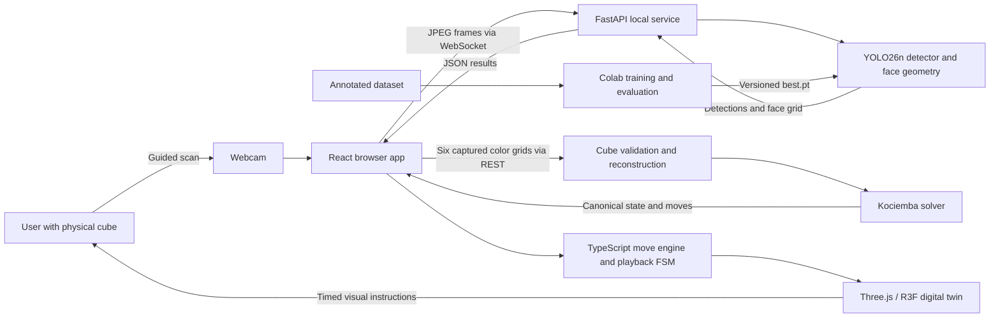
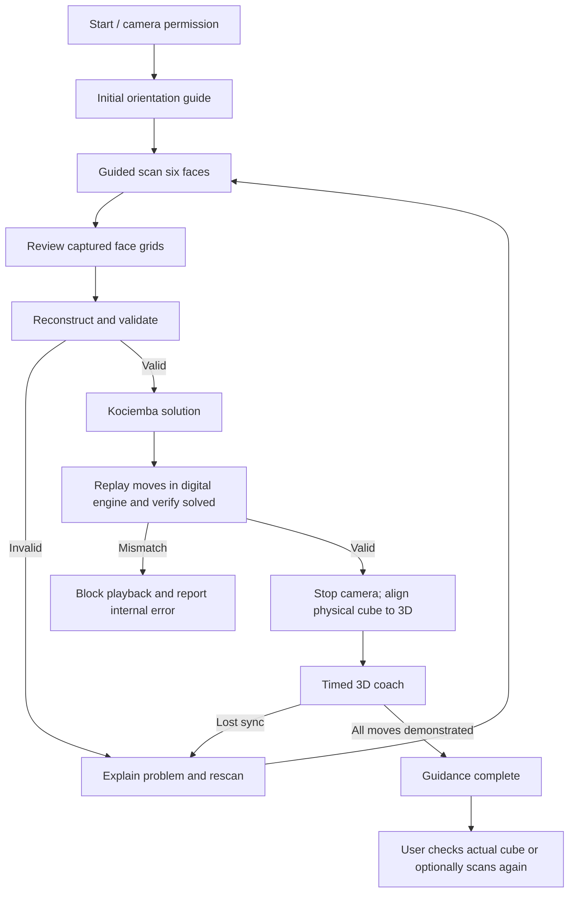
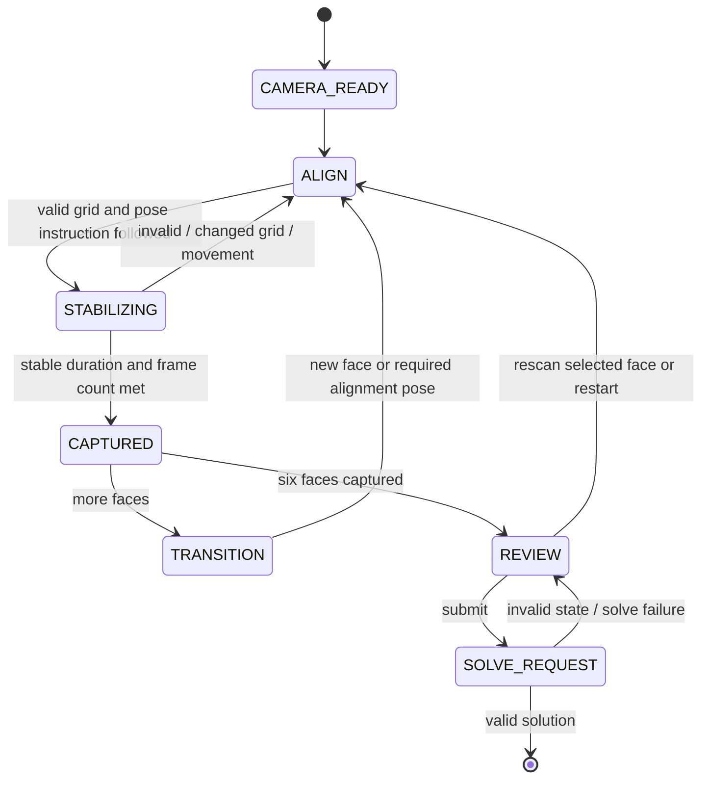
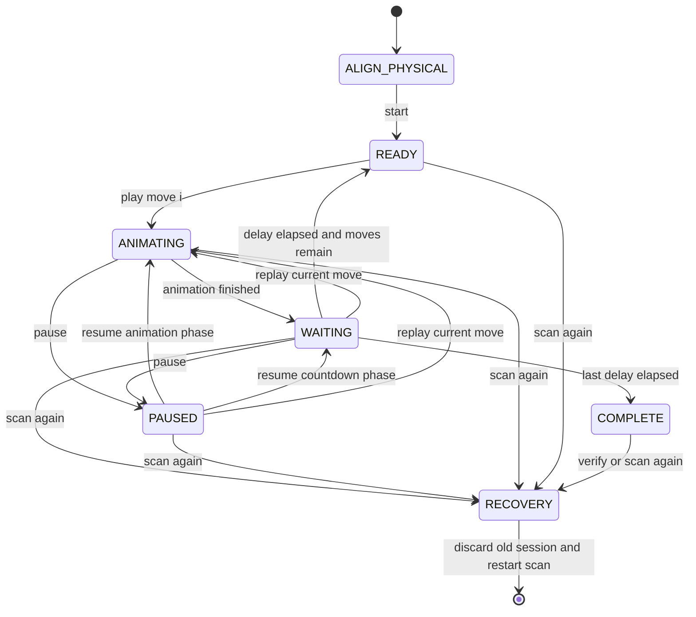

# RubikVision — System Architecture

| Field | Value |
| --- | --- |
| Version | 1.0 — architecture baseline for review |
| Date | 2026-11-19 |
| Product | AI-powered interactive 3×3 Rubik's Cube coach |
| Target | Local-first browser application; approximately one-week MVP for a Computer Vision sharing session |
| Status | Product direction and technology stack accepted; detailed contracts and tuning defaults below are proposed implementation decisions, not validated code |

## 1. Executive overview

RubikVision turns a physical scrambled 3×3 Rubik's Cube into a digital twin and teaches the user how to solve it. A custom fine-tuned YOLO26n **Object Detection** model identifies individual colored facelets during a guided webcam scan. The system reconstructs the full cube state, validates its physical solvability, runs the Kociemba two-phase solver, then renders a synchronized interactive 3D cube that automatically demonstrates each required move with an adjustable delay.

The camera is active only during scanning and optional recovery/verification. During solving, the user holds the real cube comfortably, follows the 3D demonstration, and does not need to confirm every move. If the physical cube and digital twin become unsynchronized, the user pauses and rescans the actual cube to obtain a new solution.

The core separation is intentional: **YOLO perceives; geometry reconstructs; Kociemba solves; a deterministic move engine changes the digital state; Three.js renders and animates that state.** No LLM or segmentation model is involved in the MVP.

### 1.1 Product goals

- Demonstrate a complete custom-object-detection lifecycle: labeled data, transfer learning, evaluation, model integration, and a working application.
- Let someone with little Rubik's Cube knowledge scan and solve a physical cube without learning notation first.
- Provide visual scan arrows and automatic face capture; minimize repeated clicking while both hands hold the cube.
- Keep physical, logical, and rendered cube orientations consistent, with deterministic and testable move semantics.
- Recover gracefully from poor detections, invalid states, interrupted playback, or user mistakes.

### 1.2 Decisions and alternatives

| Decision area | Selected approach | Alternatives considered / trade-off |
| --- | --- | --- |
| Perception | Fine-tuned YOLO26n detection, class per visible facelet color | HSV-only is cheaper and useful as an optional benchmark, but does not satisfy the fine-tuning objective. Segmentation is not required for a front-facing 3×3 grid. |
| Scanning | Guided six-face scanning with automatic capture and 2D overlay arrows | Random scanning needs orientation search and may be ambiguous; continuous 3D scanning requires harder pose estimation and tracking. |
| Solving UX | Hybrid coach: camera off, timed automatic demonstrations, adjustable delay, pause/replay, rescan | Per-move manual confirmation is inconvenient and superseded. Automatic camera verification during solving is out of scope. |
| Runtime | React/TypeScript browser UI + local Python/FastAPI service | Fully browser-side inference would improve portability but adds export/runtime compatibility work; native mobile is not needed for MVP. |
| 3D | Three.js + React Three Fiber, driven by a pure move engine | Render-only animations without a deterministic cube state cannot ensure solver consistency. |
| Persistence | In-memory session; local settings optional | No database, sign-in, cloud inference, or user account is necessary. |

### 1.3 Non-goals and constraints

- Support a standard 3×3 color cube with six distinct center colors; no 2×2, 4×4, picture cubes, or arbitrary non-color puzzles.
- Do not rotate or alter physical cube layers while scanning. Only whole-cube reorientation is allowed during scan.
- Do not promise automatic detection of a wrong physical move while the camera is off. Timed playback advances the **virtual** cube only.
- No true AR pose registration, random scanning, automatic move tracking, robot control, SAM, RF-DETR, or YOLO segmentation in MVP.
- No mandatory Docker, Redis, database, auth, cloud GPU inference, or production deployment.
- Educational scope: build and verify the MVP locally before optimization or public deployment.

## 2. Technology stack

| Layer | Technology | Responsibility |
| --- | --- | --- |
| Training | Python 3.11 (target), PyTorch, Ultralytics, YOLO26n (`yolo26n.pt`) | Fine-tune six-color object detector; evaluate and export `best.pt`. |
| Data | Roboflow Universe, Google Colab GPU | Obtain and inspect existing bounding-box labels; training environment. |
| Vision | OpenCV, NumPy | Image decode, ROI/geometry checks, facelet center assignment, optional perspective correction. |
| Backend | FastAPI, Uvicorn, Pydantic | WebSocket inference endpoint, REST solver API, validation and error contracts. |
| Solver | Python `kociemba` | Validate legal cube structure and find a sequence of face turns. |
| Frontend | React, TypeScript, Vite | Scanner, alignment screen, solving coach, settings, recovery UX. |
| UI | Tailwind CSS, shadcn/ui, Motion | Layout, UI components and non-cube UI transitions. |
| Browser camera | MediaDevices `getUserMedia`, Canvas 2D | Capture frames and draw bounding boxes and scan-direction arrows. |
| 3D | Three.js, React Three Fiber; Drei as needed | Render and animate digital cube; camera and orientation aids. |
| State | Zustand, pure TypeScript Cube/Move Engine, finite-state machine | Session, cube snapshots, timer, deterministic movement and recovery. |
| Communication | WebSocket (binary JPEG / JSON), REST (JSON) | Live inference during scan; one solver request per reconstructed state. |
| Test and source | pytest, Vitest, Git/GitHub | Unit, contract, integration and regression testing. |

Pin tested Python/Node dependencies in lockfiles. Validate PyTorch/CUDA compatibility and the `kociemba` package on the target machine before fixing versions. Use Colab for training if the local GPU is constrained. Local CPU inference is a supported fallback; performance must be measured. ONNX Runtime is an optional later optimization, not a dependency of P0.

## 3. System context and containers



One backend process and one browser application are sufficient. The vision model is loaded once on backend startup. The frontend owns the ephemeral scan/playback session; the backend owns frame analysis and full-state validation/solving. The inference API does not retain video or scan history by default. There is no cross-session database.

### 3.1 Responsibility boundaries

| Component | Owns | Does not own |
| --- | --- | --- |
| Camera capture | Unmirrored canonical frame bytes, image dimensions, lifecycle | Model inference or cube legality |
| Vision service | Model loading, detection normalization, face ROI geometry and grid result | Scan order, timer, physical solution |
| Scan controller | Face sequence, stable capture, orientation instruction, captured color grids | Learning model or solver implementation |
| Cube service | Center mapping, physical validation, canonical URFDLB serialization | UI and animation |
| Solver adapter | Kociemba call, allowed-move parsing and structured errors | Detection and rendering |
| Move engine | Immutable facelet state, 18 legal face-turn permutations, snapshots | Webcam, network, presentation timing |
| Renderer | Sticker placement, layer animation, virtual viewpoint | Logical truth or solving algorithm |
| Playback controller | Current move, remaining delay, pause/resume/replay, cancellation | Verification of physical moves |

## 4. End-to-end user flow



1. Ask for webcam permission, show camera preview, and explain the distinction between whole-cube and layer turns.
2. Capture faces in a guided physical sequence, using an arrow, target orientation card, progress indicator, and stable automatic capture. A visible reference model or cube diagram shows the desired center colors on the front/top as applicable.
3. Review all captured grids; allow rescan of a face with its original orientation instructions. If the original orientation is no longer known, restart the full scan rather than guessing.
4. Validate and solve. The frontend replays all returned moves into a deterministic digital model before enabling playback.
5. Stop camera stream and WebSocket. Ask the user to hold the physical cube so the same reference centers face **the user** as in the virtual front reference view.
6. Play one turn, show the resulting state, then count down to the next automatically. The user follows without per-move clicking; pause/replay/speed controls remain available.
7. On completion, report that digital guidance is complete, not that the physical cube was verified. Offer another guided scan if the user needs confirmation or a new solution.

## 5. Computer vision and model training

### 5.1 Detection target and class contract

Detect one bounding box per visible colored **facelet** (one sticker or colored plastic square), not the entire cube, whole side, or multi-face cubie. Target six classes:

| ID (canonical dataset mapping) | Label |
| --- | --- |
| 0 | `white` |
| 1 | `yellow` |
| 2 | `red` |
| 3 | `orange` |
| 4 | `blue` |
| 5 | `green` |

These IDs are an implementation contract for the curated dataset; actual downloaded IDs must be inspected and remapped, or normalized explicitly from model class names. Never assume a third-party dataset uses this order. Backend startup verifies the trained model's six class names and the ID mapping; unknown or missing classes fail readiness.

### 5.2 Dataset candidates and audit gate

Primary search candidates (not selected, downloaded, or audited yet):

| Candidate | Source |
| --- | --- |
| Face Cube Rubik | https://universe.roboflow.com/rubiks/face-cube-rubik-6a7bk |
| Rubiks Cube Colors (Ryukung) | https://universe.roboflow.com/ryukung/rubiks-cube-colors-eoclo |
| Rubiks Cube Colors (Dhyan Thacker) | https://universe.roboflow.com/dhyan-thacker/rubiks-cube-colors |

Before training:

- Confirm access, license, attribution, annotation type, all six color classes and class distributions. A listed dataset is not proof of suitability.
- Inspect annotations on different cube styles, lighting, orientations, backgrounds, hands, reflections, and occlusions. Include full and partial visible faces as correctly labeled examples; only front-facing complete faces are accepted by the scanner.
- Require complete labels for visible target facelets. Reject/correct ambiguous color labels and invalid bounding boxes. If the chosen source supplies polygons, convert each individual facelet polygon to an enclosing box and inspect the result; no mask inference is needed.
- Split by recording session/source/cube where possible before augmentation. Detect exact/near-duplicate images; never let variants of one source image cross splits. Keep a separate real webcam test set from the actual demo setup.
- Record source URLs, dataset version, license, remapping, original/augmented counts and preprocessing in a dataset manifest. Do not merge datasets until schemas and duplicate checks are reconciled.

Expected YOLO detection layout:

```text
datasets/rubik/
├── data.yaml
├── train/{images,labels}/
├── valid/{images,labels}/
└── test/{images,labels}/
```

Each label line is `class_id x_center y_center width height` with normalized coordinates. `data.yaml` uses `train: train/images`, `val: valid/images`, `test: test/images` and the six labels defined above, relative to the selected dataset root.

### 5.3 Training baseline

- Initialize from `yolo26n.pt` (detection, COCO-pretrained); fine-tune for all six classes.
- Proposed starting configuration: `imgsz=640`, 50 epochs, seed recorded, early stopping and batch size chosen for actual GPU memory. Tune only after a measured baseline. These are experiment defaults, not guaranteed optimums.
- Avoid hue-changing augmentations that would invalidate color labels; use moderate brightness/contrast, scale, translation, rotation and perspective as appropriate. Inspect resulting examples. Never augment validation/test.
- Save best checkpoint, training configuration, Ultralytics/PyTorch versions, class names, dataset manifest and evaluation report. Record the weight SHA-256/hash or version in the runtime manifest. Do not silently use a generic COCO checkpoint when custom weights are missing.

### 5.4 Runtime detection contract and face ordering

YOLO returns class ID, confidence and `xyxy` bounding boxes. Normalize output to the original transmitted frame pixel coordinates (undo any model preprocessing). The center is `(xmin+xmax)/2, (ymin+ymax)/2`.

For MVP, require the cube to be held relatively straight and centered inside a fixed scan ROI. Filter detections by confidence, dimensions, ROI membership and overlap. Reject ambiguous duplicates, multiple faces/cubes in ROI, occlusion or partial grids rather than silently inventing missing colors. Do not add arbitrary NMS if the installed model already handles duplicate suppression; use an explicit geometric duplicate/ambiguity check at the grid stage.

Baseline grid algorithm:

1. Require exactly nine eligible boxes after deterministic filtering; sort their centers by image Y.
2. Split into three successive groups of three, and sort each group by image X.
3. Validate row/column separation, approximate spacing, box size consistency, center proximity to grid middle, and non-overlap. Verify all nine assignments are distinct and fit the 3×3 region.
4. Return nine colors in camera image row-major order (top left to bottom right). Otherwise return a reason such as `INCOMPLETE_GRID`, `AMBIGUOUS_GRID`, or `TILT_TOO_LARGE`.

A count of nine alone is insufficient. Sorting by Y then X is valid only for sufficiently upright, nearly frontal faces. If tests indicate it is inadequate, estimate planar geometry/homography from reliable grid/corner correspondences, rectify, and sort again; otherwise ask the user to straighten the cube. Do not claim arbitrary pose support from axis-aligned boxes.

### 5.5 Metrics and provisional acceptance targets

| Metric | Meaning / release check |
| --- | --- |
| Precision, recall, mAP50, mAP50–95 | Report on held-out boxes and per class; record confusion, especially red/orange and white/yellow. |
| Exact face accuracy | Percentage of labeled complete face images for which all nine colors and positions are correct. Proposed target ≥95% on supported frontal demo conditions. |
| Exact cube reconstruction | Compare all 54 positions and center mapping to ground truth for a known scramble; proposed target at least 9/10 independent guided scan sessions. |
| False acceptance | Wrong or partial grid incorrectly auto-captured; log and investigate every observed event. |
| End-to-end success | User solves physical cube from a known scrambled state following timed coach; demonstrate at least three distinct scrambles. |
| Runtime latency / FPS | Measure inference p50/p95, browser-to-result latency, and effective result rate on target hardware; initial target 5–10 result FPS if feasible, not a guarantee. |

Targets are proposed and must be validated; if the exact-state target fails, narrow supported conditions, improve data or scan gating before demo. Report actual test denominators, not just mAP. The optional HSV/contour baseline can be evaluated on the same face images and latency setup for educational comparison; do not replace YOLO in the primary product.

## 6. Canonical cube state and guided scanning

This is a correctness-critical contract between scanning, solver and 3D. The solver and renderer must never use different notions of front, right, or clockwise.

### 6.1 Reference frame

Use a right-handed coordinate system: `+X = R`, `+Y = U`, `+Z = F`. Opposites are `L=-X`, `D=-Y`, `B=-Z`. View each face directly from outside the cube; its top-left-to-bottom-right row order is normative. All directions refer to the **cube frame**, not whichever way the camera happens to look.

Initially instruct the user to present the green center to the webcam with the white center on top (six-color conventional cube). U/F are perpendicular; the remaining centers are identified from the guided whole-cube rotations, rather than assuming right is always red. Example for a conventional scheme: U white, F green, R red, B blue, L orange, D yellow. If a cube does not support this starting pair, MVP may reject it clearly; general U/F selection is an extension. The true center mapping is reconstructed from captured faces and must contain each of the six colors exactly once.

**Camera versus human viewpoint:** during scanning, F initially faces the webcam. During solving, F must face the user, with U above and R on the user's right as in the 3D reference view. Reorient the entire physical cube after scanning to achieve this. Do not simply tell the user to keep the exact last scan pose. Keep image-coordinate reconstruction unmirrored even if a selfie-style preview is offered; any display mirroring must be mapped consistently or disabled (MVP default: disabled).

### 6.2 Guided scan order and orientation table

Scan order is `F → R → B → L → U → D`. This is not the solver serialization order. The table defines the exact physical pose for each capture; top neighbor and right neighbor refer to the outside-view image, not arbitrary color stickers.

| Stage | Face toward camera | Neighbor at image top | Neighbor at image right | Whole-cube movement from reference/previous stage |
| --- | --- | --- | --- | --- |
| 1 | F | U | R | Start: green toward camera, white up. |
| 2 | R | U | B | Yaw whole cube so original right comes toward camera; keep U up. |
| 3 | B | U | L | Repeat same yaw quarter turn. |
| 4 | L | U | F | Repeat same yaw quarter turn. |
| 5 | U | B | R | First yaw back to F with U up, then tilt the whole cube so U faces camera and B is at image top. |
| 6 | D | F | R | From U-facing pose, rotate entire cube 180° around the same horizontal axis, so D faces camera and F is at image top. |

Use clear animated 2D arrows plus a small reference-cube orientation diagram; at stage 5 explicitly distinguish the return-to-F transition from the tilt-to-U transition. Do not capture while rotating. An intermediate alignment instruction can verify the already captured F pattern (when available) before accepting U. Avoid ambiguous text such as “rotate left” alone; name the face that must come toward the camera and display the expected orientation. If the next center was not captured before, it cannot be verified against a known arbitrary mapping; require an uncaptured center, appropriate instructed pose and any known center constraints. In particular, U must be white under the starting convention. Optional expected opposite-center checks should only assume a supported known scheme or observed information.

**Limitation:** a single facelet image with nine boxes and a center color cannot prove the rotations around the face normal or the identity of hidden adjacent faces. Guided gestures, diagrams, validation, review and rescan reduce risk but do not provide pose verification. A physically legal but wrong reconstruction is possible and must be acknowledged. No claim of true AR or automatic orientation recognition.

### 6.3 Auto-capture state machine

The frontend owns the scan sequence and stability buffer. One face is accepted exactly once per stage; a new stage clears stability.



Proposed tuning: confidence threshold 0.5, stable grid for at least 1 second and at least five consecutive accepted results; reset on invalid frame, a changed color layout, substantial center drift, or new stage. Cap target send rate at 10 FPS initially; require minimum result cadence or extend wait rather than misrepresent stability. Tune thresholds on the real webcam; thresholds are not hard correctness guarantees. Overlay coordinates are derived from the same frame's boxes and the actual displayed image crop/scale (use `object-fit: contain` or account for letterboxing); arrow can be anchored to the grid bounds. This is a 2D guide, not 3D pose registration.

Provide manual recovery (restart/rescan, camera permission retry) and visual feedback for incomplete/wrong-face/tilted/unstable grids. A capture sound is optional and must not be the only feedback. Review screen shows six captured color matrices with fixed center labels; do not silently correct errors or change face order.

### 6.4 Canonical state format

The semantic source of truth is an immutable 54-character **facelet string** in Kociemba order `U R F D L B`. Each character denotes the home face of the sticker's **color**, not the geometric face on which that sticker currently sits. `centerColors` maps six face identifiers to the actual RGB/color classes for rendering. The face lists captured by the scanner are color strings; translate each sticker color via the inverse center mapping. Concatenate row-major grids in solver order, not capture order.

```text
Offsets: U=0, R=9, F=18, D=27, L=36, B=45
Index = offset(face) + 3*row + col      # row/col are zero-based
Solved: UUUUUUUUURRRRRRRRRFFFFFFFFFDDDDDDDDDLLLLLLLLLBBBBBBBBB
```

| Face | Normal n | Image right a | Image down b |
| --- | --- | --- | --- |
| U | +Y | +X | +Z |
| R | +X | -Z | -Y |
| F | +Z | +X | -Y |
| D | -Y | +X | -Z |
| L | -X | +Z | -Y |
| B | -Z | -X | -Y |

For a facelet at row `r`, column `c` in `{0,1,2}`, its cubie position is `p = n + (c-1)*a + (r-1)*b`; sticker normal is `n`. This table is shared by the scanner contract, TypeScript move engine and renderer. Test against Kociemba's published facelet mapping, including asymmetric faces and back/down orientations; symmetric solved faces alone cannot detect row rotation bugs.

### 6.5 Validation and solver adapter

Before calling solver: ensure six grids with nine entries each; six distinct center colors; every color occurs exactly nine times; fixed center positions map to their own letters; legal edge/corner identities occur exactly once, edge flips sum to 0 mod 2, corner twists sum to 0 mod 3, and permutation parity of edges and corners matches. Use a tested cube validator or the Kociemba library's legality checks, not a second ad hoc solver. Catch invalid-state failures; provide clear generic rescan guidance if the library doesn't expose the precise problem. Neither color counts nor physical legality alone proves the photographed cube was reconstructed accurately.

Pass normalized facelet string to `kociemba.solve`; handle an already-solved cube with an empty move list, and handle solver exceptions/timeouts without starting playback. Parse only `U R F D L B` with optional `'` or `2` (18 tokens). No `x/y/z`, slice turns, wide turns, or regrips are part of the solver's output contract. Kociemba finds a valid solution, not necessarily a globally shortest solution.

## 7. Digital twin and deterministic move engine

### 7.1 State and rendering invariant

The frontend receives `{centerColors, initialState, moves}`. A pure TypeScript engine can apply any legal turn to a facelet string; it contains no browser, Three.js or timer dependencies. Compute immutable snapshots `S[0..N]`, where `S[0]` is the scanned state and `S[i+1] = applyMove(S[i], moves[i])`. Verify final snapshot equals solved state before playback. Reject invalid responses or internal inconsistency; never animate a known-wrong sequence.

Create 26 visible cubies (8 corners, 12 edges, 6 centers) and 54 sticker surfaces; the internal core can be omitted or rendered separately. Colors come from `centerColors[state[index]]`. Use the canonical coordinate table, not a random scramble generated by the renderer. Every renderable sticker has a cubie position and outward normal. Cube state is authoritative; scene transforms are transient presentation only.

### 7.2 Move semantics

A clockwise turn is 90 degrees **as viewed directly from outside the target face**. With the right-hand rule, rotate -90° around that face's outward normal; prime turns are +90°, double turns are 180°. Apply rotation to both cubie positions and sticker normals of the selected layer, then map back to canonical indices. For exact logical state use integer permutation/coordinate transformations rather than floating-point geometry.

| Move | Layer predicate | Axis | Standard clockwise angle about positive axis |
| --- | --- | --- | --- |
| R | x = +1 | X | -90° |
| L | x = -1 | X | +90° |
| U | y = +1 | Y | -90° |
| D | y = -1 | Y | +90° |
| F | z = +1 | Z | -90° |
| B | z = -1 | Z | +90° |

The renderer animates the selected layer around the same logical axis/sign, then snaps to the exact next snapshot. A scene group may be used as a temporary pivot; after animation it must not retain cumulative drift or stale parent transforms. Camera orbit changes viewpoint only, never the canonical state. A small permanent orientation indicator shows U/F/R center colors even when inspecting the back or bottom. Instructions explicitly say which center color and viewing direction define a clockwise turn. If the user changes grip, guide them back to the reference pose.

### 7.3 Timed solving controller



Define `i` as the index of the currently demonstrated move. During animation display interpolation `S[i] → S[i+1]`; during waiting display `S[i+1]`. The virtual cube may be ahead of the user's physical cube until the user follows. When the delay expires, increment `i` once. Replay restores `S[i]` visually and demonstrates the same transition, resets that move's waiting period and never commits its permutation twice. UI shows move label, target center color, directed arrow, current/total count, next move preview and a countdown.

Proposed defaults: 1 second animation (180° can use the same duration or a tuned longer one), 5 seconds delay **after** the animation, adjustable delay 2–15 seconds and optional sound. Delay is not a prediction of human completion. Speed changes during an active countdown take effect at the next step (simpler deterministic default); pause preserves remaining time/animation progress, resume continues from it. At the start there is one deliberate Start action. No per-move Done click is required. Provide Space pause/resume and replay shortcuts as optional convenience, with accessible click controls. Never autoplay when entering alignment screen or recovering without user consent.

Use monotonic time, a single active animation/countdown, cancellation and a session generation token. Stop (and suspend rather than fast-forward) on hidden tab, component unmount, rescan or stale callback. Avoid overlapping animation loops and React Strict Mode duplicate effects. Completion follows final waiting interval; display `Guidance complete — check your physical cube`, not verified success. If the initial state is already solved, skip playback and show the same appropriate status. Rescan always creates a fresh state and solution and invalidates previous snapshots/results; it does not try to guess which physical move was missed.

## 8. Interfaces and communication contracts

### 8.1 Runtime endpoints

| Endpoint | Method | Purpose |
| --- | --- | --- |
| `/health` | GET | Process alive; readiness flag, safe model version and device info. |
| `/ws/scan` | WebSocket | Binary JPEG frame in, JSON detections and per-frame grid analysis out. |
| `/api/solve` | POST | Validate six captured color grids, return canonical state, center mapping and solution. |

All payload examples are proposed v1 contracts, not existing endpoints. Use Pydantic validation, stable error codes and a schema version; frontend TypeScript types mirror the contracts and are tested with fixtures. Frontend owns scan ordering, auto-capture, and capture review; backend owns single-frame geometry and canonical state/solver validation. Avoid a stateful backend scan session unless subsequently needed.

### 8.2 WebSocket scanning protocol

One accepted frame in flight per client; send only latest frame at configured cadence when previous response returns. Raw JPEG in binary (no base64); one JSON result per frame. On connection send an initial JSON hello carrying `schemaVersion` and `scanId`, receive ack, then stream binary frames. Server sequences responses from 1 for each connection; frontend tracks the capture-request stage locally and discards response from a stale connection/stage. On reconnect generate a new `scanId`, reset in-flight tracking and the stability buffer. Use actual decoded frame dimensions; reject oversized/malformed frames. Proposed bounds: 1280 px longest edge and 1 MiB payload; measure before tuning.

Example response (excerpt: one detection shown; `grid:null` because only one detection is represented):

```json
{
  "type": "frame_result",
  "schemaVersion": 1,
  "scanId": "scan-42",
  "frameSeq": 15,
  "width": 640,
  "height": 480,
  "detections": [
    {"classId": 4, "color": "blue", "confidence": 0.96, "xyxy": [218, 120, 260, 164]}
  ],
  "grid": null,
  "quality": {"valid": false, "reason": "INCOMPLETE_GRID"},
  "inferenceMs": 75
}
```

Valid `grid` is a nine-element row-major color array from the unmirrored frame; `quality.valid` true indicates only frame geometry validity, not pose verification or stable auto-capture. Stabilization is frontend logic comparing multiple results and the current stage. Frame rejection returns a typed error/result and allows recovery; unrecoverable server/model failure shows actionable UI. Bound concurrent inference with a single worker or lock around the model; run blocking decode/inference outside the async event loop, and do not launch an unbounded task per frame. Load model once, warm up as needed. Client capture loop must stop when leaving scanning mode; stop media tracks as well as the socket.

### 8.3 REST solver contract

Request `POST /api/solve` takes `faces` keyed by face direction after orientation normalization and `schemaVersion=1`. Every value is a nine-element row-major color list. This example uses a solved cube for readability; actual scramble grids differ.

```json
{
  "schemaVersion": 1,
  "faces": {
    "U": ["white","white","white","white","white","white","white","white","white"],
    "R": ["red","red","red","red","red","red","red","red","red"],
    "F": ["green","green","green","green","green","green","green","green","green"],
    "D": ["yellow","yellow","yellow","yellow","yellow","yellow","yellow","yellow","yellow"],
    "L": ["orange","orange","orange","orange","orange","orange","orange","orange","orange"],
    "B": ["blue","blue","blue","blue","blue","blue","blue","blue","blue"]
  }
}
```

Successful response for that exact request:

```json
{
  "schemaVersion": 1,
  "centerColors": {"U":"white","R":"red","F":"green","D":"yellow","L":"orange","B":"blue"},
  "initialState": "UUUUUUUUURRRRRRRRRFFFFFFFFFDDDDDDDDDLLLLLLLLLBBBBBBBBB",
  "moves": [],
  "moveCount": 0
}
```

For a scrambled cube, `moves` contains legal tokens and `moveCount` equals array length. Frontend precomputes and verifies all snapshots before proceeding. Treat timeout as retryable, never fabricate a solution. Use 422 for invalid input/state, 503 for unavailable service, and an appropriate timeout/internal response for solver faults. Suggested normalized error envelope:

```json
{"error":{"code":"INVALID_CUBE_STATE","message":"The captured cube could not be validated. Check face orientation or scan again.","retryable":true}}
```

Potential codes: `INVALID_FACE_SHAPE`, `DUPLICATE_CENTER`, `COLOR_COUNT_MISMATCH`, `INVALID_CUBE_STATE`, `SOLVER_TIMEOUT`, `MODEL_UNAVAILABLE`, `FRAME_TOO_LARGE`, `INVALID_FRAME`. Do not assert an exact erroneous face unless evidence supports it. The client cancels/ignores stale solve results after rescan. Solve is called once per full state (again on recovery), not once per move.

### 8.4 Interaction sequence

```mermaid
sequenceDiagram
    participant User
    participant UI as React Scanner
    participant CV as FastAPI Vision
    participant Solver as Cube / Kociemba
    participant Coach as 3D Coach
    User->>UI: Start and align cube
    loop Guided face capture
        UI->>CV: JPEG frame
        CV-->>UI: Detections and ordered grid / quality
        UI->>UI: Stability gate and save face
        UI-->>User: Next whole-cube arrow
    end
    UI->>Solver: POST six reviewed grids
    Solver->>Solver: Validate and solve
    Solver-->>UI: Canonical state, centers, moves
    UI->>UI: Verify digital solution by replay
    UI->>UI: Close camera and scan socket
    UI-->>User: Align physical cube to reference
    User->>Coach: Start
    loop Each move
        Coach-->>User: Animate turn + countdown
        User->>User: Follow on physical cube
        Coach->>Coach: Advance virtual state after delay
    end
    Coach-->>User: Guidance complete; check physical cube
```

## 9. Frontend screens and state ownership

| Screen | Main behavior |
| --- | --- |
| Home / onboarding | Explain scanning versus solving, permissions, supported cube and quick start. |
| Guided scanner | Live webcam, grid ROI, detection overlay, progress F/R/B/L/U/D, orientation card, auto-capture feedback and scan errors. |
| Review | Six captured 3×3 grids, validation feedback, rescan controls. |
| Align / ready | Reference-view 3D cube and center-color instructions; solution available; camera off. |
| Solving coach | Digital twin, move notation, direction, face center, countdown, play/pause/replay, speed, Scan Again. |
| Completion | Guidance-complete message, optional verification/rescan; no claim of physical success unless verified. |

Zustand stores three related but separately resettable slices: `scan` (captured faces, stage, camera/connection status, stability), `cube` (center map, initial state, validated moves and immutable snapshots), and `playback` (session ID, phase, current move, delay/animation settings, remaining time). Keep high-frequency frame bytes and mutable Three.js object refs outside the global reactive store; update UI using bounded results. Canvas overlays and renderer read state, they do not mutate source-of-truth facelets. Settings can optionally persist via `localStorage`; no captured images/state saved persistently by default. Include accessible keyboard controls and text labels in addition to color cues; sound is optional.

## 10. Suggested repository organization

```text
rubikvision/
├── ARCHITECTURE.md
├── README.md
├── .gitignore
├── backend/
│   ├── app/
│   │   ├── main.py
│   │   ├── config.py
│   │   ├── api/{health.py,scan.py,solve.py}
│   │   ├── schemas/{vision.py,cube.py,errors.py}
│   │   ├── vision/{detector.py,facelet_sorter.py,grid_validator.py}
│   │   └── cube/{reconstruction.py,validator.py,solver.py}
│   ├── weights/              # best.pt supplied externally; not tracked by default
│   ├── tests/
│   ├── requirements.txt
│   └── .env.example
├── frontend/
│   ├── src/
│   │   ├── components/
│   │   ├── features/{scanner,review,align,cube,solver}/
│   │   ├── engine/{cube-state.ts,move-engine.ts,playback-fsm.ts}
│   │   ├── stores/{scan-store.ts,cube-store.ts,playback-store.ts}
│   │   ├── hooks/
│   │   ├── services/{scan-client.ts,solver-client.ts}
│   │   └── types/
│   ├── tests/
│   ├── package.json
│   └── .env.example
├── training/
│   ├── configs/
│   ├── notebooks/
│   ├── train.py
│   ├── evaluate.py
│   └── dataset-manifest.md
├── datasets/                 # local, gitignored
├── fixtures/                 # small, permitted synthetic / recorded test cases
└── docs/                     # decisions and evaluation reports
```

Module names are a suggested responsibility-based layout; builder may simplify files while preserving boundaries. Do not commit credentials, large datasets, raw personal videos or unapproved model weights. Keep training separate from runtime; the API must not train on startup.

## 11. Local operation, robustness and privacy

- Proposed dev addresses: frontend `http://localhost:5173`, backend `http://127.0.0.1:8000`. Use Vite proxy for `/api`, `/ws` and `/health` or an explicitly configured allowed local origin; configure WebSocket upgrade and validate origin separately from REST CORS. For a production-like local build, use one origin or approved proxy. Do not expose a development GPU server on the public network by default.
- Browser webcam requires a secure context (localhost is generally supported; remote clients need HTTPS); use `wss` with HTTPS. Respect camera permissions and offer retry. Release camera media tracks on solve, navigation, errors and unmount. No background scanning during solving.
- Environment examples: `RUBIK_MODEL_PATH`, `RUBIK_DEVICE=auto`, `RUBIK_CONFIDENCE`, `RUBIK_MAX_FRAME_BYTES`, `RUBIK_ALLOWED_ORIGINS`. Never require API credentials for normal local runtime. Keep server config distinct from browser public env variables.
- Bounded frame queues (drop stale frames), request/camera timeout, serialized inference, and solver timeout; avoid freezing the async loop or browser. If a server task cannot be interrupted immediately, ignore stale results and cap concurrency. Frontend stops playback on unexpected data/state inconsistency.
- Log metadata (frame count, quality reason, latency, model ID, solve outcome) rather than image content. Do not transmit frames to third-party cloud services in runtime. Capture test footage only with permission. Keep sessions ephemeral.
- Check dataset license and dependency/model licenses before public distribution. Ultralytics YOLO26 is offered under AGPL-3.0 and Enterprise licensing; review applicable obligations. Verify Kociemba and all other dependency licenses; preserve dataset attribution and model provenance.

## 12. Verification strategy and acceptance criteria

A successful mAP score alone cannot demonstrate that the full cube solver works. Test layer boundaries independently and combine them only after their contracts are verified.

| Test group | Required checks |
| --- | --- |
| Dataset/model | Six labels mapped correctly; invalid annotation checks; source-aware split; reproducible training metadata; held-out box/face metrics. |
| Vision geometry | Shuffled boxes order correctly; reject eight/ten detections, duplicates, occlusion, wrong ROI, unstable and overly tilted grids; coordinate overlay scales correctly; unmirrored asymmetric face fixture. |
| Guided scanner | F/R/B/L/U/D order; unobserved center policy; U/D corner orientation; no capture during transition; no duplicate stage captures; reset buffer on movement/stage changes; rescan and reconnect safely. |
| Reconstruction | Solved input; known asymmetric scramble; six unique centers; 9 counts each; edge/corner legality; impossible swaps/flips/twists blocked; verify expected URFDLB string. |
| Solver | Already solved returns empty moves; known scrambles return legal tokens; invalid states and errors do not animate; move replay reaches solved. |
| Move engine | Each of 18 moves; move followed by inverse is identity; quarter turn four times is identity; half turn twice is identity; centers fixed; sticker counts conserved; compare asymmetric move results against an independent reference implementation, not just inverse tests. |
| 3D rendering | All 54 sticker transforms/colors correspond to canonical indices; correct six-axis animation sign; renderer final state equals next snapshot; camera orbit does not change state; no cumulative drift. |
| Playback | One timer/animation, correct pause/resume in both phases, replay doesn't double-apply, hidden tab suspends, speed policy deterministic, final countdown, no stale callback after rescan. |
| API contract | Successful and failed solve; invalid JSON/JPEG/oversize; frame sequence; single in-flight flow; reconnect and stale results; missing model; browser permission failure. |
| End-to-end | Scan a solved cube; scan a known scramble, verify recovered state against independent ground truth, follow physical solution; deliberately miss a move then rescan; demonstrate camera off during solving. |

P0 release criteria: custom trained weights are loaded; user can scan all six faces with guided arrows and auto-capture; correct state can be validated and reconstructed; digital replay of every accepted solution reaches solved; 3D displays correct turns in order; timed autoplay/pause/resume/replay and full rescan recovery work; measured exact-state and end-to-end results are recorded. See §5.5 for proposed quantitative gates. If physical test fails, report failure and narrow the demo rather than substituting hardcoded state or a prerecorded success as live inference.

## 13. Implementation dependency order (not an implementation plan)

| Stage | Deliverable / exit condition |
| --- | --- |
| A. Dataset & model | Audited six-color labeled dataset, fine-tuned `best.pt`, real webcam validation images and baseline metrics. |
| B. Deterministic cube contract | Canonical fixtures, validator and solver, pure move engine checked against reference and known moves. Can be developed independently of model training using fixtures. |
| C. Scan pipeline | Webcam → WebSocket → YOLO → ordered grid, guided sequence and stable capture, six-face review. |
| D. 3D coach | Canonical digital twin, layer animation, adjustable timed playback, pause/replay and orientation guide. |
| E. Integration & demo | Full scan → solve → playback, rescan recovery, fault handling, end-to-end physical testing. |

Prioritize B alongside model work so a late training issue does not prevent testing solver correctness. A task-level implementation plan and TDD sequencing are separate artifacts to write after this architecture is reviewed. No source code, dependencies or tests have been implemented by this document.

## 14. Risks, assumptions and open validation

| Risk | Mitigation / decision |
| --- | --- |
| Wrong sticker color despite high confidence | Inspect real-world data; stable exact grids; review; benchmark whole-face/cube accuracy instead of assuming confidence proves correctness. |
| Incorrect face orientation or camera mirroring | Canonical orientation contract, clear pose guide, unmirrored capture, asymmetric tests; rescan rather than silently rotate. |
| Physically legal but incorrect scanned state | Independent known-scramble tests, review and full rescan; disclose that legality is not observation truth. |
| Solver/renderer rotation mismatch | Exact coordinate table, independent move fixtures, pre-playback replay to solved, render snapshot comparison. |
| User misses a move during autoplay | Adjustable delay, pause/replay; scan again. Camera-off playback is intentionally unverified. |
| Browser/CPU/GPU latency | Frame backpressure, bounded inference, local CPU fallback; profile first; consider ONNX only if needed. |
| Dataset access or licensing | Audit available candidate and license before choosing; do not promise immediate training or public deployment. |
| Scope creep | P0 focuses on one cube and local browser; continuous AR, tracking, mobile deployment, voice and backend scaling are deferred. |

Accepted product decisions come from the design discussion: YOLO Object Detection, guided scan, hybrid camera-off solving, timed automatic guidance, recovery by rescan and selected local web stack. Architecture-author choices that remain to be verified: exact API schema, coordinate implementation, fixed initial white/green pair, scan gate thresholds, frame cap, default durations, timeout policies, metric targets, test setup and library versions. These are explicit proposed defaults; builder may tune them without changing the core product behavior. Dataset remains unselected and model untrained. No implementation or runtime benchmark has been performed.

## 15. References

- Inspiration: https://youtu.be/uLl0EFAlyX0 (video description supplied by the user; original demo uses RF-DETR segmentation, not the chosen architecture).
- YOLO26 model documentation and licensing: https://docs.ultralytics.com/models/yolo26
- YOLO object detection: https://docs.ultralytics.com/tasks/detect/
- Kociemba Python adapter and facelet convention: https://github.com/muodov/kociemba
- Kociemba facelet/cubie reference: https://github.com/hkociemba/RubiksCube-TwophaseSolver
- WCA face-turn notation: https://www.worldcubeassociation.org/regulations/#article-12-notation
- FastAPI WebSockets: https://fastapi.tiangolo.com/advanced/websockets/
- Browser webcam: https://developer.mozilla.org/en-US/docs/Web/API/MediaDevices/getUserMedia
- React Three Fiber: https://r3f.docs.pmnd.rs/
- Similar projects for reference only: https://github.com/Super-Morse/rubiks-visual-detector and https://github.com/JimWid/Rubiks_Cube_Solver

---

**Design review gate:** accept or amend this architecture before creating a task-level implementation plan or scaffolding the project. In particular, validate the canonical facelet mapping and an asymmetric known-scramble fixture early. The document describes intended behavior; it does not establish that the system already works.
