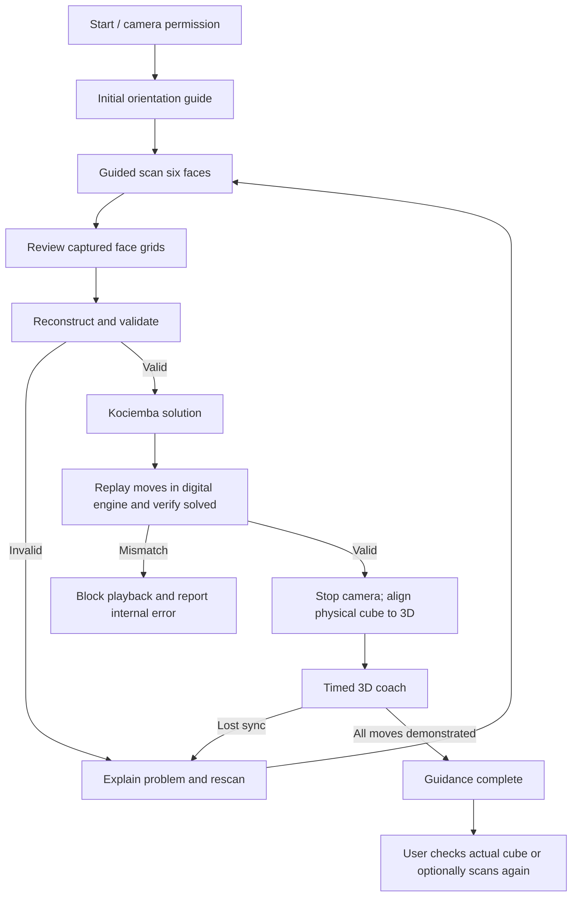
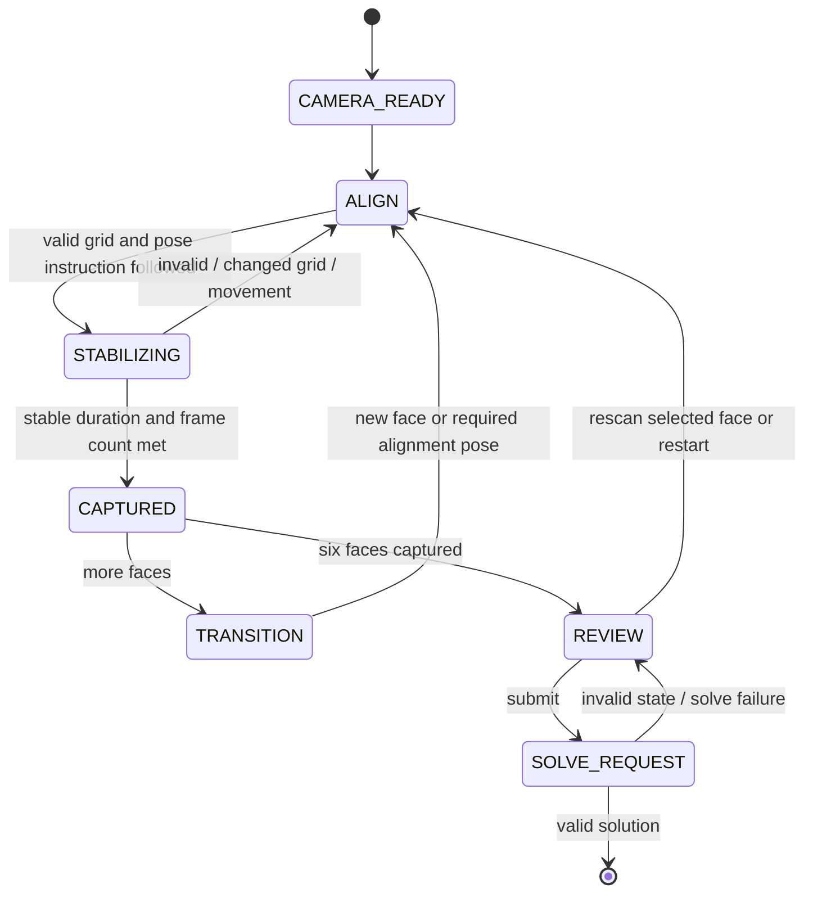
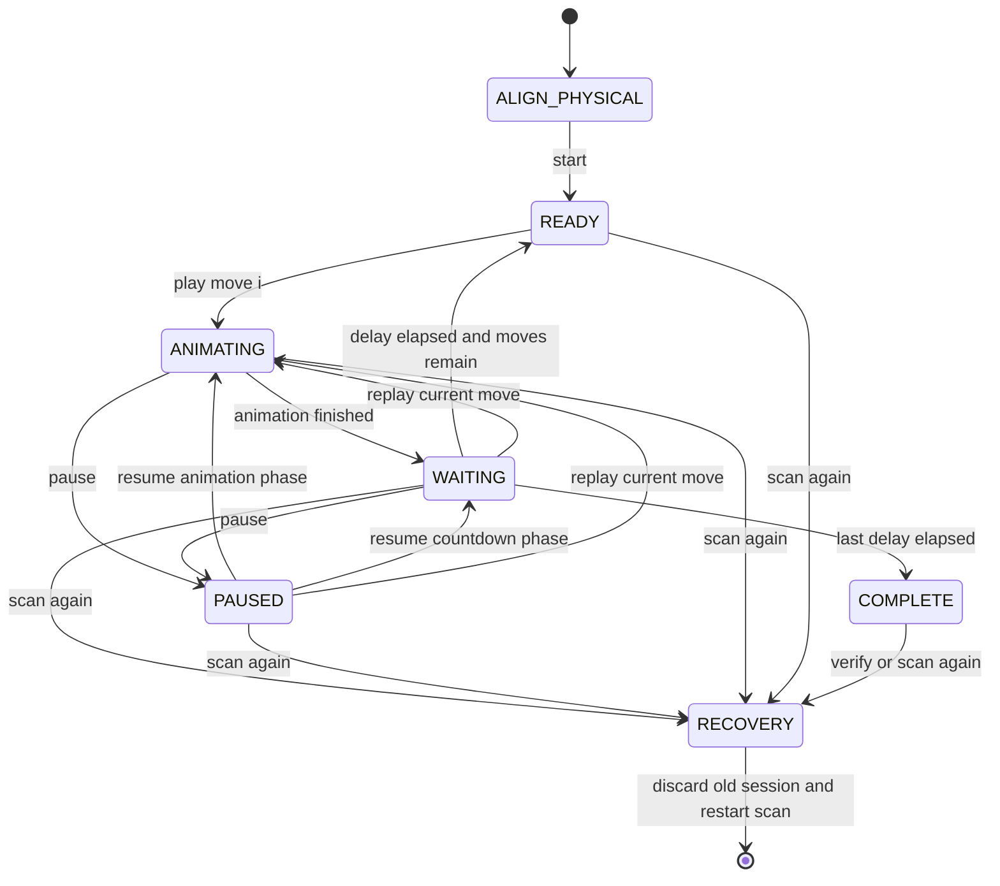

# RubikVision — System Architecture

| Field | Value |
| --- | --- |
| Version | 1.3 — Phase 3 real YOLO26s live scanning (WebSocket protocol, grid analysis, guided scan UI) |
| Date | 2026-11-23/24 (v1.2: 2026-11-23; v1.1: 2026-11-22; v1.0: 2026-11-19) |
| Product | AI-powered interactive 3×3 Rubik's Cube coach |
| Target | Local-first browser application; approximately one-week MVP for a Computer Vision sharing session |
| Status | Phases 0, 1 and 2 are complete and merged into `main`. Phase 3 (real YOLO26s live scanning: `/ws/scan`, detector loading and health, guide-square cell analysis, guided scan UI) is implemented on branch `feat/phase-3-live-vision` and awaits the user's approval; evidence is in `docs/superpowers/reports/phase3-verification.md`. The model was trained externally and its checkpoint `backend/weights/best.pt` (git-ignored, not in the repository) is loaded at startup when present. It was exercised in a browser only with Chrome's fake camera device. **The physical webcam gate was NOT RUN** (the user performs it, see `docs/superpowers/reports/phase3-physical-test-checklist.md`) and nothing has been verified against a physical cube. The inference-latency budget was not met on the development machine (section 11 and 14). |

### Changelog

**v1.3 (2026-11-23/24)** — Phase 3 live vision (design `docs/superpowers/specs/2026-11-23-phase-3-live-vision-design.md`, plan `docs/superpowers/plans/2026-11-23-phase-3-live-vision.md`, evidence `docs/superpowers/reports/phase3-verification.md`):

- Phase 3 is redefined as **real YOLO26s live scanning**. The earlier split (Phase 3 detector interface and `FixtureDetector`, Phase 4 `YoloDetector` adapter, Phase 5 training, Phase 6 weights) is superseded by the user's reframing: the model had already been trained externally before Phase 3 began, so no fixture detector and no training phase are built (section 13).
- Section 2 gains the vision stack (Ultralytics 8.4.216 AGPL-3.0, CPU-only torch 2.14.1, `websockets` 17.4, OpenCV). Section 5.4 is the runtime detection contract as built (YOLO26s loaded once at startup, classes mapped by name, sanitized health reasons, `RUBIK_*` settings).
- Sections 6.2 and 6.3 describe the guide-square cell analysis, the start-convention gate, auto-capture rules and the rotation cue as built, and what they do **not** verify.
- Section 8.1 marks all three endpoints as existing. Section 8.2 is rewritten to the protocol as built: the client crops the guide square, which **supersedes the proposed server-side `roi`**; `hello`, `ready`, `frame_result` and `error` messages with their exact keys; Origin required; one global inference lock.
- Section 10 shows the actual tree (`backend/app/vision/`, `api/scan_ws.py`, `fixtures/vision/`, the frontend `lib/`, `hooks/` and scanner files). The pure scan machine lives in `frontend/src/lib/live-scan-machine.ts`.
- Section 11 records measured resources (python process 2.27 GB resident while scanning, about 1.2 CPU cores) and the AGPL note. Section 12 records the fake-camera browser gate and the NOT RUN physical gate. Section 14 gains the Phase 3 risks, including the unmet performance budget, the start-command blocker (uvicorn had no WebSocket library; found only by a real browser against a real server) and the observations O1 to O6.
- Stale wording fixed: Phase 2 is merged (it said "awaiting approval").

**v1.2 (2026-11-23)** — Phase 2 backend (design `docs/superpowers/specs/2026-11-22-phase-2-backend-design.md`, evidence `docs/superpowers/reports/phase2-verification.md`):

- Solver is `cube-solver` 1.1.4 (MIT), chosen by measurement, behind a `Solver` protocol; the GPL `kociemba` package is not used. Resource costs (one-time table build, about 1.6 GB disk and RAM) are recorded in sections 2 and 11.
- Own backend validation (facelets, cubie legality) and a server-side replay of every solution; the response is never trusted from the library alone (section 6.5).
- `GET /health` and `POST /api/solve` exist; `/ws/scan` does not (section 8.1). HTTP status and error-code map for the solve endpoint (section 8.3). The wire contract is unchanged; internal faults are a bare 500.
- Section 10 shows the actual `backend/` tree (no `vision/`, no `weights/` yet). Section 11 gains solver licence, resources and configuration.
- Section 12.1: the Python cross-check is done (TypeScript-generated fixtures, backend-recorded responses bound by the frontend, 300-state slow check).
- Sections 13 and 14: Phase 1 complete and merged, Phase 2 implemented awaiting approval; design risks R1 to R8 recorded; the model is now named YOLO26s throughout (trained externally; at v1.2 it was not integrated, which Phase 3 changed in v1.3). Phase 2 has since been merged.

**v1.1 (2026-11-22)** — model-last amendments from the Phase 0/1 plan (section 11) and decisions made while executing Phase 1:

- Section 13 replaced by the model-last roadmap with *software-ready* and *model-ready* gates; the release criteria in section 12 are split the same way.
- Detector modes `RUBIK_DETECTOR_MODE=fixture|yolo`, additive `/health` fields, `MODEL_UNAVAILABLE` behaviour; fixture readiness never enables unlabelled live capture (sections 5.1, 8.1, 11).
- Scan rules: known centres come from the scan; nine boxes cannot prove face roll; the UI never names the colour of an unobserved centre (section 6).
- ROI, contain-fit overlay, one frame in flight, camera lifecycle rules (section 8.2).
- `FaceletState` is authoritative and `RenderCubie[]` is a derived adapter; strict runtime parsing; solve response bound to the request; client-only error codes; `runSolve` precondition (sections 7.1, 8.3).
- Playback reducer, single clock, `frameRef` renderer contract, no skip/previous controls, "Guidance time", orientation cue, confirmation before completion (section 7.3).
- New sections: Demo vs Live (9.1), Independent engine verification (12.1), Phase 1 scope decisions (12.2).
- Section 10 now shows the actual repository tree; section 14 gains the known limitations found in Phase 1.

**v1.0 (2026-11-19)** — architecture baseline.

## 1. Executive overview

RubikVision turns a physical scrambled 3×3 Rubik's Cube into a digital twin and teaches the user how to solve it. A custom fine-tuned YOLO26s **Object Detection** model (trained externally; the checkpoint `backend/weights/best.pt` is git-ignored and loaded by the backend at startup, v1.3) identifies individual colored facelets during a guided webcam scan. The system reconstructs the full cube state, validates its physical solvability, runs the Kociemba two-phase solver, then renders a synchronized interactive 3D cube that automatically demonstrates each required move with an adjustable delay.

The camera is active only during scanning and optional recovery/verification. During solving, the user holds the real cube comfortably, follows the 3D demonstration, and does not need to confirm every move. If the physical cube and digital twin become unsynchronized, the user pauses and rescans the actual cube to obtain a new solution.

The core separation is intentional: **YOLO perceives; geometry reconstructs; Kociemba solves; a deterministic move engine changes the digital state; Three.js renders and animates that state.** No LLM or segmentation model is involved in the MVP.

### 1.1 Product goals

- Demonstrate a complete custom-object-detection lifecycle: labeled data, transfer learning, evaluation, model integration, and a working application.
- Let someone with little Rubik's Cube knowledge scan and solve a physical cube without learning notation first.
- Provide visual scan arrows and automatic face capture; minimize repeated clicking while both hands hold the cube.
- Keep physical, logical, and rendered cube orientations consistent, with deterministic and testable move semantics.
- Recover gracefully from poor detections, invalid states, interrupted playback, or user mistakes.

### 1.2 Decisions and alternatives

| Decision area | Selected approach | Alternatives considered / trade-off |
| --- | --- | --- |
| Perception | Fine-tuned YOLO26s detection (trained externally, integrated for live scanning in Phase 3), class per visible facelet color | HSV-only is cheaper and useful as an optional benchmark, but does not satisfy the fine-tuning objective. Segmentation is not required for a front-facing 3×3 grid. |
| Scanning | Guided six-face scanning with automatic capture and 2D overlay arrows | Random scanning needs orientation search and may be ambiguous; continuous 3D scanning requires harder pose estimation and tracking. |
| Solving UX | Hybrid coach: camera off, timed automatic demonstrations, adjustable delay, pause/replay, rescan | Per-move manual confirmation is inconvenient and superseded. Automatic camera verification during solving is out of scope. |
| Runtime | React/TypeScript browser UI + local Python/FastAPI service | Fully browser-side inference would improve portability but adds export/runtime compatibility work; native mobile is not needed for MVP. |
| 3D | Three.js + React Three Fiber, driven by a pure move engine | Render-only animations without a deterministic cube state cannot ensure solver consistency. |
| Persistence | In-memory session; local settings optional | No database, sign-in, cloud inference, or user account is necessary. |

### 1.3 Non-goals and constraints

- Support a standard 3×3 color cube with six distinct center colors; no 2×2, 4×4, picture cubes, or arbitrary non-color puzzles.
- Do not rotate or alter physical cube layers while scanning. Only whole-cube reorientation is allowed during scan.
- Do not promise automatic detection of a wrong physical move while the camera is off. Timed playback advances the **virtual** cube only.
- No true AR pose registration, random scanning, automatic move tracking, robot control, SAM, RF-DETR, or YOLO segmentation in MVP.
- No mandatory Docker, Redis, database, auth, cloud GPU inference, or production deployment.
- Educational scope: build and verify the MVP locally before optimization or public deployment.

## 2. Technology stack

| Layer | Technology | Responsibility |
| --- | --- | --- |
| Training | Python 3.11 (target), PyTorch, Ultralytics, YOLO26s (`yolo26s.pt`) | Fine-tune six-color object detector; evaluate and export `best.pt`. The YOLO26s model was trained externally (Colab) and is **not** part of this repository. Training artefacts live in the git-ignored parts of the user's `training/` folder; runtime and training stay separate. |
| Data | Roboflow Universe, Google Colab GPU | Obtain and inspect existing bounding-box labels; training environment. The dataset (`quang-phuc-ngo/rubik-2mkm7` v3, CC BY 4.0) is attributed in `fixtures/vision/ATTRIBUTION.md`. |
| Vision runtime | Ultralytics 8.4.216 (**AGPL-3.0**), PyTorch 2.14.1 and torchvision 0.29.2 (CPU-only wheels from the PyTorch CPU index), OpenCV 5.1.0 (`opencv-python`), NumPy 2.5.5 | Load `backend/weights/best.pt` once at startup, run CPU inference on the guide-square JPEG, decode untrusted frames. Versions are those resolved in `backend/uv.lock` at the time of the Phase 3 report. GPU is not used (section 11). |
| Vision geometry | Pure Python (`backend/app/vision/grid.py`) | Per-cell 3×3 analysis of the detections on the square guide crop (section 6.2). |
| Backend | FastAPI, Uvicorn, `websockets` 17.4 (BSD-3-Clause), Pydantic | WebSocket inference endpoint, REST solver API, validation and error contracts. `websockets` is required: without a WebSocket library uvicorn answers every upgrade with 404 (section 14, D1). |
| Solver | Python `cube-solver` 1.1.4 (MIT), Kociemba two-phase algorithm; own validator and replay | Find a sequence of face turns after the backend's own legality check. Costs: one-time table build (about 5–7 minutes: 282.8 s Task 5 build, 386.6 s design benchmark first build), `pruning_kociemba.npz` 1634.2 MB plus `transition.npz` 2.0 MB on disk, about 1.6 GB resident while serving. Python pinned to 3.12 (no cp314 wheel). |
| Frontend | React, TypeScript, Vite | Scanner, alignment screen, solving coach, settings, recovery UX. |
| UI | Tailwind CSS, shadcn/ui, Motion | Layout, UI components and non-cube UI transitions. |
| Browser camera | MediaDevices `getUserMedia`, Canvas 2D | Capture frames and draw bounding boxes and scan-direction arrows. |
| 3D | Three.js, React Three Fiber; Drei as needed | Render and animate digital cube; camera and orientation aids. |
| State | Zustand, pure TypeScript Cube/Move Engine, finite-state machine | Session, cube snapshots, timer, deterministic movement and recovery. |
| Communication | WebSocket (binary JPEG / JSON), REST (JSON) | Live inference during scan (`/ws/scan`, section 8.2); one solver request per reconstructed state. |
| Test and source | pytest, Vitest, Git/GitHub | Unit, contract, integration and regression testing. |

Pin tested Python/Node dependencies in lockfiles. Validate PyTorch/CUDA compatibility on the target machine before fixing versions. The backend dependencies are pinned in `backend/uv.lock` (`uv`, Python 3.12). Use Colab for training if the local GPU is constrained. Local CPU inference is a supported fallback; performance must be measured. ONNX Runtime is an optional later optimization, not a dependency of P0.

## 3. System context and containers


One backend process and one browser application are sufficient. The vision model is loaded once on backend startup. The frontend owns the ephemeral scan/playback session; the backend owns frame analysis and full-state validation/solving. The inference API does not retain video or scan history by default. There is no cross-session database.

### 3.1 Responsibility boundaries

| Component | Owns | Does not own |
| --- | --- | --- |
| Camera capture | Unmirrored canonical frame bytes, image dimensions, lifecycle | Model inference or cube legality |
| Vision service | Model loading, detection normalization, face ROI geometry and grid result | Scan order, timer, physical solution |
| Scan controller | Face sequence, stable capture, orientation instruction, captured color grids | Learning model or solver implementation |
| Cube service | Center mapping, physical validation, canonical URFDLB serialization | UI and animation |
| Solver adapter | Kociemba call, allowed-move parsing and structured errors | Detection and rendering |
| Move engine | Immutable facelet state, 18 legal face-turn permutations, snapshots | Webcam, network, presentation timing |
| Renderer | Sticker placement, layer animation, virtual viewpoint | Logical truth or solving algorithm |
| Playback controller | Current move, remaining delay, pause/resume/replay, cancellation | Verification of physical moves |

## 4. End-to-end user flow



1. Ask for webcam permission, show camera preview, and explain the distinction between whole-cube and layer turns.
2. Capture faces in a guided physical sequence, using an arrow, target orientation card, progress indicator, and stable automatic capture. A visible reference model or cube diagram shows the desired center colors on the front/top as applicable.
3. Review all captured grids; allow rescan of a face with its original orientation instructions. If the original orientation is no longer known, restart the full scan rather than guessing.
4. Validate and solve. The frontend replays all returned moves into a deterministic digital model before enabling playback.
5. Stop camera stream and WebSocket. Ask the user to hold the physical cube so the same reference centers face **the user** as in the virtual front reference view.
6. Play one turn, show the resulting state, then count down to the next automatically. The user follows without per-move clicking; pause/replay/speed controls remain available.
7. On completion, report that digital guidance is complete, not that the physical cube was verified. Offer another guided scan if the user needs confirmation or a new solution.

## 5. Computer vision and model training

### 5.1 Detection target and class contract

Detect one bounding box per visible colored **facelet** (one sticker or colored plastic square), not the entire cube, whole side, or multi-face cubie. Target six classes:

| ID (canonical dataset mapping) | Label |
| --- | --- |
| 0 | `white` |
| 1 | `yellow` |
| 2 | `red` |
| 3 | `orange` |
| 4 | `blue` |
| 5 | `green` |

The integrated checkpoint's own class order is alphabetical (`{0: blue, 1: green, 2: orange, 3: red, 4: white, 5: yellow}`), which differs from this table; the runtime therefore maps by **name** and never relies on an ID order (section 5.4). These IDs are an implementation contract for the curated dataset; actual downloaded IDs must be inspected and remapped, or normalized explicitly from model class names. Never assume a third-party dataset uses this order. Backend startup verifies the trained model's six class names and the ID mapping; unknown or missing classes fail readiness. Normalise detections by class **name**, never by assumed ID; verify all six names and the detection task; reject extra, missing or unknown labels. Weights are not committed (`*.pt` is git-ignored); a trusted local `backend/weights/best.pt` is loaded once at startup, and replacing it requires a restart. A missing or invalid file never falls back to generic COCO weights.

### 5.2 Dataset candidates and audit gate

Primary search candidates (not selected, downloaded, or audited yet; ColorRubik2 is a priority audit candidate and the Pavitras dataset a backup, both unaudited). Collect a small independent real-image test set early and train late:

| Candidate | Source |
| --- | --- |
| Face Cube Rubik | https://universe.roboflow.com/rubiks/face-cube-rubik-6a7bk |
| Rubiks Cube Colors (Ryukung) | https://universe.roboflow.com/ryukung/rubiks-cube-colors-eoclo |
| Rubiks Cube Colors (Dhyan Thacker) | https://universe.roboflow.com/dhyan-thacker/rubiks-cube-colors |

Before training:

- Confirm access, license, attribution, annotation type, all six color classes and class distributions. A listed dataset is not proof of suitability.
- Inspect annotations on different cube styles, lighting, orientations, backgrounds, hands, reflections, and occlusions. Include full and partial visible faces as correctly labeled examples; only front-facing complete faces are accepted by the scanner.
- Require complete labels for visible target facelets. Reject/correct ambiguous color labels and invalid bounding boxes. If the chosen source supplies polygons, convert each individual facelet polygon to an enclosing box and inspect the result; no mask inference is needed.
- Split by recording session/source/cube where possible before augmentation. Detect exact/near-duplicate images; never let variants of one source image cross splits. Keep a separate real webcam test set from the actual demo setup.
- Record source URLs, dataset version, license, remapping, original/augmented counts and preprocessing in a dataset manifest. Do not merge datasets until schemas and duplicate checks are reconciled.

Expected YOLO detection layout:

```text
datasets/rubik/
├── data.yaml
├── train/{images,labels}/
├── valid/{images,labels}/
└── test/{images,labels}/
```

Each label line is `class_id x_center y_center width height` with normalized coordinates. `data.yaml` uses `train: train/images`, `val: valid/images`, `test: test/images` and the six labels defined above, relative to the selected dataset root.

### 5.3 Training baseline

- Initialize from `yolo26s.pt` (detection, COCO-pretrained); fine-tune for all six classes. The user has already done this externally (Colab). The checkpoint is **not** in this repository; it is loaded from the git-ignored `backend/weights/best.pt` (Phase 3). Its provenance is recorded in the Phase 3 design (SHA-256 `93b727eca123…a1a17e0`, Ultralytics 8.4.216, trained at `imgsz=640`, Roboflow `rubik-2mkm7` v3, epoch 43). Dataset audit and retraining were not part of Phase 3 and remain deferred; they are needed only if the physical test shows the model is insufficient.
- Proposed starting configuration: `imgsz=640`, 50 epochs (50 versus 60 is a tunable baseline, not a decision), seed recorded, early stopping and batch size chosen for actual GPU memory. Tune only after a measured baseline. These are experiment defaults, not guaranteed optimums.
- Avoid hue-changing augmentations that would invalidate color labels; use moderate brightness/contrast, scale, translation, rotation and perspective as appropriate. Inspect resulting examples. Never augment validation/test.
- Save best checkpoint, training configuration, Ultralytics/PyTorch versions, class names, dataset manifest and evaluation report. Record the weight SHA-256/hash or version in the runtime manifest. Do not silently use a generic COCO checkpoint when custom weights are missing.

### 5.4 Runtime detection contract and face ordering

**As built (Phase 3).** The proposed full-frame sort-by-Y-then-X algorithm below was **not** implemented. Phase 3 assigns detections to the cells of a fixed square guide (section 6.2); the text that follows is kept as the rejected alternative and as the escalation path if the physical test shows the guide approach is insufficient.

- **Detector.** `backend/app/vision/yolo_detector.py` (`YoloDetector`) wraps the YOLO26s checkpoint. It is loaded **once** during application startup (blocking, before the app serves, after the solver tables) and warmed up with one inference. `create_app(detector=...)` accepts a test double. The loader never downloads or substitutes weights: `YOLO_OFFLINE=1` and `YOLO_CONFIG_DIR=backend/.ultralytics/` (git-ignored) are set when the caller has not set them.
- **Validation at load.** The file must exist and be readable; the device must be `cpu` or an available `cuda:N`; Ultralytics must load it; the model `task` must be `detect`; the class names must be exactly the six colour names. Class IDs are mapped **by name** (`class_map`), never by assumed ID. Any failure raises `ModelUnavailable` and the app still starts: `/health` reports `degraded` and `/ws/scan` answers `MODEL_UNAVAILABLE`; the solver stays usable. There is no fallback to COCO or fixture detections.
- **Sanitized reasons.** `ModelUnavailable` has a fixed public `reason` (for example "Detection weights not found.", "The model is not a detection model.", "The model's class names are not the six cube colours.", "The requested inference device is not available.") that `/health` may show, and a private `detail` (paths, raw exception text) that is only logged. Health never exposes an absolute path.
- **Model version.** `<train_args.name or file stem>@<sha256[:12]>`, for the integrated checkpoint `yolo26s_rubik_v1@93b727eca123`. It appears in `/health` and in the WebSocket `ready` message.
- **Inference call.** `predict(image, imgsz=RUBIK_IMGSZ, conf=RUBIK_CONFIDENCE, device=RUBIK_DEVICE, agnostic_nms=False)`; boxes are returned as `xyxy` in the pixel space of the submitted (square, unmirrored) image.
- **Settings (`backend/app/config.py`, read once at startup).** Invalid values raise a configuration error; there is no silent default for a malformed value.

| Variable | Default | Rule |
| --- | --- | --- |
| `RUBIK_DETECTOR_MODE` | `yolo` | Only `yolo` is accepted. |
| `RUBIK_SOLVER_CACHE_DIR` | `backend/.solver-cache/` | Phase 2. |
| `RUBIK_SOLVER_TIMEOUT_S` | `10` | Phase 2. |
| `RUBIK_MODEL_PATH` | `backend/weights/best.pt` (absolute) | Never empty. A relative value is resolved against `backend/`, not the current directory; a drive-relative value such as `C:foo` is rejected. |
| `RUBIK_CONFIDENCE` | `0.5` | Finite number strictly between 0 and 1. |
| `RUBIK_IMGSZ` | `640` | Positive multiple of 32. The documented latency lever (section 14). |
| `RUBIK_DEVICE` | `cpu` | `cpu` or `cuda:N`. Only CPU torch is installed, so `cuda:N` fails at load with a clear `degraded` reason. |
| `RUBIK_MAX_FRAME_BYTES` | `1048576` | Positive integer. |
| `RUBIK_MAX_FRAME_EDGE` | `1280` | Positive integer. |
| `RUBIK_ALLOWED_ORIGINS` | `http://127.0.0.1:5173,http://localhost:5173` | Comma-separated; compared by exact string equality (no wildcard semantics). |

YOLO returns class ID, confidence and `xyxy` bounding boxes. Normalize output to the original transmitted frame pixel coordinates (undo any model preprocessing). The center is `(xmin+xmax)/2, (ymin+ymax)/2`.

For MVP, require the cube to be held relatively straight and centered inside a fixed scan ROI. Filter detections by confidence, dimensions, ROI membership and overlap. Reject ambiguous duplicates, multiple faces/cubes in ROI, occlusion or partial grids rather than silently inventing missing colors. Do not add arbitrary NMS if the installed model already handles duplicate suppression; use an explicit geometric duplicate/ambiguity check at the grid stage.

Baseline grid algorithm:

1. Require exactly nine eligible boxes after deterministic filtering; sort their centers by image Y.
2. Split into three successive groups of three, and sort each group by image X.
3. Validate row/column separation, approximate spacing, box size consistency, center proximity to grid middle, and non-overlap. Verify all nine assignments are distinct and fit the 3×3 region.
4. Return nine colors in camera image row-major order (top left to bottom right). Otherwise return a reason such as `INCOMPLETE_GRID`, `AMBIGUOUS_GRID`, or `TILT_TOO_LARGE`.

A count of nine alone is insufficient. Sorting by Y then X is valid only for sufficiently upright, nearly frontal faces. If tests indicate it is inadequate, estimate planar geometry/homography from reliable grid/corner correspondences, rectify, and sort again; otherwise ask the user to straighten the cube. Do not claim arbitrary pose support from axis-aligned boxes.

### 5.5 Metrics and provisional acceptance targets

| Metric | Meaning / release check |
| --- | --- |
| Precision, recall, mAP50, mAP50–95 | Report on held-out boxes and per class; record confusion, especially red/orange and white/yellow. |
| Exact face accuracy | Percentage of labeled complete face images for which all nine colors and positions are correct. Proposed target ≥95% on supported frontal demo conditions. |
| Exact cube reconstruction | Compare all 54 positions and center mapping to ground truth for a known scramble; proposed target at least 9/10 independent guided scan sessions. |
| False acceptance | Wrong or partial grid incorrectly auto-captured; log and investigate every observed event. |
| End-to-end success | User solves physical cube from a known scrambled state following timed coach; demonstrate at least three distinct scrambles. |
| Runtime latency / FPS | Measure inference p50/p95, browser-to-result latency, and effective result rate on target hardware; initial target 5–10 result FPS if feasible, not a guarantee. |

Targets are proposed and must be validated; if the exact-state target fails, narrow supported conditions, improve data or scan gating before demo. Report actual test denominators, not just mAP. The optional HSV/contour baseline can be evaluated on the same face images and latency setup for educational comparison; do not replace YOLO in the primary product.

## 6. Canonical cube state and guided scanning

This is a correctness-critical contract between scanning, solver and 3D. The solver and renderer must never use different notions of front, right, or clockwise.

### 6.1 Reference frame

Use a right-handed coordinate system: `+X = R`, `+Y = U`, `+Z = F`. Opposites are `L=-X`, `D=-Y`, `B=-Z`. View each face directly from outside the cube; its top-left-to-bottom-right row order is normative. All directions refer to the **cube frame**, not whichever way the camera happens to look.

Initially instruct the user to present the green center to the webcam with the white center on top (six-color conventional cube). This green-front/white-up pair is the documented **start convention** only; every other centre colour is taken from the faces actually scanned, and the full six-centre mapping is never hard-coded. U/F are perpendicular; the remaining centers are identified from the guided whole-cube rotations, rather than assuming right is always red. Example for a conventional scheme: U white, F green, R red, B blue, L orange, D yellow. If a cube does not support this starting pair, MVP may reject it clearly; general U/F selection is an extension. The true center mapping is reconstructed from captured faces and must contain each of the six colors exactly once.

**Camera versus human viewpoint:** during scanning, F initially faces the webcam. During solving, F must face the user, with U above and R on the user's right as in the 3D reference view. Reorient the entire physical cube after scanning to achieve this. Do not simply tell the user to keep the exact last scan pose. Keep image-coordinate reconstruction unmirrored even if a selfie-style preview is offered; any display mirroring must be mapped consistently or disabled (MVP default: disabled).

### 6.2 Guided scan order and orientation table

Scan order is `F → R → B → L → U → D`. This is not the solver serialization order. The table defines the exact physical pose for each capture; top neighbor and right neighbor refer to the outside-view image, not arbitrary color stickers.

| Stage | Face toward camera | Neighbor at image top | Neighbor at image right | Whole-cube movement from reference/previous stage |
| --- | --- | --- | --- | --- |
| 1 | F | U | R | Start: green toward camera, white up. |
| 2 | R | U | B | Yaw whole cube so original right comes toward camera; keep U up. |
| 3 | B | U | L | Repeat same yaw quarter turn. |
| 4 | L | U | F | Repeat same yaw quarter turn. |
| 5 | U | B | R | First yaw back to F with U up, then tilt the whole cube so U faces camera and B is at image top. |
| 6 | D | F | R | Return to the front (green toward the camera, white on top), then tilt the bottom of the whole cube toward the camera, so D faces camera and F is at image top. (v1.3: this replaces the earlier "rotate 180° from the U pose"; the final pose is the same.) |

Use clear animated 2D arrows plus a small reference-cube orientation diagram; at stage 5 explicitly distinguish the return-to-F transition from the tilt-to-U transition. Do not capture while rotating. An intermediate alignment instruction can verify the already captured F pattern (when available) before accepting U. Avoid ambiguous text such as “rotate left” alone; name the face that must come toward the camera and display the expected orientation. If the next center was not captured before, it cannot be verified against a known arbitrary mapping; require an uncaptured center, appropriate instructed pose and any known center constraints. In particular, U must be white under the starting convention. Optional expected opposite-center checks should only assume a supported known scheme or observed information.

The scan UI (`frontend/src/features/scanner/scan-guide.ts`) names a centre colour only when that centre has already been observed (for example F is green and U is white under the start convention); for an unobserved centre it names the face direction instead. Stage 5 tells the user to return to F before tilting the top toward the camera, and stage 6 to return to F before tilting the bottom toward the camera (a two-step list in the UI; the Phase 3 golden `legacy-scan-guide.json` changed for U and D only).

**Guide-square cell analysis (as built, Phase 3).** The frontend crops the **square guide** from the unmirrored video frame (side `0.72 × min(frame width, frame height)`, centred, floored to integers; at most 640 px, never upscaled) and sends that square JPEG (`frontend/src/lib/scan-roi.ts`, `frame-grabber.ts`, JPEG quality 0.85). `backend/app/vision/grid.py` (`analyze(detections, size)`) then works in the crop's pixel space, with cell size `c = size / 3`:

1. Detections with confidence below 0.5, or with a box centre outside the square, are dropped. Each remaining detection falls in the cell that contains its centre (row-major, top-left first).
2. Per cell the highest-confidence detection wins. If another colour in the same cell has confidence at least `0.6 ×` the winner's, the cell is **ambiguous** (colour and confidence are `null`; nothing is guessed).
3. The winner is **misaligned** unless its centre is within `0.30 × c` of the cell centre, both box sides are between `0.35 × c` and `1.10 × c`, and the width/height ratio is between 0.6 and 1.67. Misaligned cells keep their colour and confidence for display.
4. With two or more kept cells, a largest-to-smallest box-area ratio above 2.5 (or a non-positive area) is **tilted**: every kept cell is marked misaligned.
5. A cell without any detection is **missing**. The grid is valid only when all nine cells are `ok`; the result then carries the nine colours in image row-major order. Otherwise `quality.reason` is the first that applies of `NO_FACE` (all nine missing), `TILTED`, `AMBIGUOUS`, `MISALIGNED`, `INCOMPLETE`.

The analysis never rotates or mirrors the grid and never fills a colour. A valid result means only that nine confident, aligned cells were seen in this one frame.

**Start-convention gate and auto-capture rules (as built).** The pure machine `frontend/src/lib/live-scan-machine.ts` (no React, timers or network; the hook `hooks/useLiveScan.ts` drives it) owns the stage order and the stability buffer:

- **Stability.** A face is captured only after **5 consecutive valid results with identical grids and at least 1000 ms** since the first of them (`STABLE_RESULTS`, `STABLE_MS`). A non-finite timestamp never satisfies the time gate.
- **Gate (checked before storing).** The F centre must be green and the U centre must be white (start convention); the R, B and L centres must not be white (this closes a U deadlock); a centre colour that was already captured for another face is rejected (this alone rejects "green again after a wrong tilt"); a rescanned face must reproduce its previously captured centre. A rejection shows a hint that stays latched while the same centre keeps showing. These checks catch some mistakes only; the opposite-centre relation is not checked.
- **Capture.** The machine moves on only when the store accepts the grid (`onCapture()` returns true: event `CAPTURE_STORED`); on failure it emits `CAPTURE_FAILED`, stays on the stage, clears the streak and shows "Could not save this face — hold steady to try again." Every `CAPTURE_STORED`, `CAPTURE_FAILED`, `ROTATION_DONE`, `RESCAN` and `RESET` increments an **epoch**; results carrying an older epoch are ignored, so a stale result from a previous attempt can never confirm a later capture.
- **Rotation cue.** After a capture the machine is `rotating` for 1500 ms (`ROTATION_MS`) and the loop sends no frames. The cue is a compact block that replaces the status strip below the video (never overlapping the guide): an arrow, the next face to bring toward the camera and the caption "Follow the arrow and the reference cube — the app checks colours, not how you hold the cube." The reference cube in the side panel shows the next pose; the F stage shows the start pose (green toward the camera, white on top). Reduced-motion users get a static arrow.
- **After the sixth face** the camera tracks, the socket and the loop are stopped, and about 1.2 s later the app moves to Reconstruction (once, only on the false-to-true transition of "all six captured", so "Back to scan" does not bounce).
- **What this does not verify.** Centre-colour checks do not prove whole-cube orientation or face roll, and nine confident boxes with a centre colour cannot identify a hidden neighbour. No text in the UI claims pose verification. A legal but wrong reconstruction remains possible; Phase 2 legality and the review screen reduce, but do not remove, that risk.

**Limitation:** a single facelet image with nine boxes and a center color cannot prove the rotations around the face normal or the identity of hidden adjacent faces. Guided gestures, diagrams, validation, review and rescan reduce risk but do not provide pose verification. A physically legal but wrong reconstruction is possible and must be acknowledged. No claim of true AR or automatic orientation recognition.

### 6.3 Auto-capture state machine

The frontend owns the scan sequence and stability buffer. One face is accepted exactly once per stage; a new stage clears stability.



The state diagram above is the proposed model; the machine as built is described at the end of section 6.2 (it adds `rotating`, a `done` phase and an epoch; there is no separate review step inside the scan loop, the existing Reconstruction screen is the review). Proposed tuning (implemented as: confidence threshold 0.5 in the backend, stable grid for at least 1 second and at least five consecutive accepted results): reset on invalid frame, a changed color layout, substantial center drift, or new stage. Cap target send rate at 10 FPS initially; require minimum result cadence or extend wait rather than misrepresent stability. Tune thresholds on the real webcam; thresholds are not hard correctness guarantees. Overlay coordinates are derived from the same frame's boxes and the actual displayed image crop/scale (use `object-fit: contain` or account for letterboxing); arrow can be anchored to the grid bounds. This is a 2D guide, not 3D pose registration.

Provide manual recovery (restart/rescan, camera permission retry) and visual feedback for incomplete/wrong-face/tilted/unstable grids. A capture sound is optional and must not be the only feedback. Review screen shows six captured color matrices with fixed center labels; do not silently correct errors or change face order.

### 6.4 Canonical state format

The semantic source of truth is an immutable 54-character **facelet string** in Kociemba order `U R F D L B`. Each character denotes the home face of the sticker's **color**, not the geometric face on which that sticker currently sits. `centerColors` maps six face identifiers to the actual RGB/color classes for rendering. The face lists captured by the scanner are color strings; translate each sticker color via the inverse center mapping. Concatenate row-major grids in solver order, not capture order.

```text
Offsets: U=0, R=9, F=18, D=27, L=36, B=45
Index = offset(face) + 3*row + col      # row/col are zero-based
Solved: UUUUUUUUURRRRRRRRRFFFFFFFFFDDDDDDDDDLLLLLLLLLBBBBBBBBB
```

| Face | Normal n | Image right a | Image down b |
| --- | --- | --- | --- |
| U | +Y | +X | +Z |
| R | +X | -Z | -Y |
| F | +Z | +X | -Y |
| D | -Y | +X | -Z |
| L | -X | +Z | -Y |
| B | -Z | -X | -Y |

For a facelet at row `r`, column `c` in `{0,1,2}`, its cubie position is `p = n + (c-1)*a + (r-1)*b`; sticker normal is `n`. This table is shared by the scanner contract, TypeScript move engine and renderer. Test against Kociemba's published facelet mapping, including asymmetric faces and back/down orientations; symmetric solved faces alone cannot detect row rotation bugs.

### 6.5 Validation and solver adapter

Before calling solver: ensure six grids with nine entries each; six distinct center colors; every color occurs exactly nine times; fixed center positions map to their own letters; legal edge/corner identities occur exactly once, edge flips sum to 0 mod 2, corner twists sum to 0 mod 3, and permutation parity of edges and corners matches. The backend has its own validator (`backend/app/cube/legality.py`, independent of the solver library): it derives corner and edge identities from the section 6.4 geometry and checks identity, twist, flip and parity with a separate test per check. The solver library's own rejection is not relied on. Catch invalid-state failures; provide clear generic rescan guidance if the library doesn't expose the precise problem. Neither color counts nor physical legality alone proves the photographed cube was reconstructed accurately.

Pass the normalized facelet string to the solver adapter (`cube-solver`, see section 2). An already-solved cube returns an empty move list without calling the library. Every solution the library returns is replayed server-side with the backend's own move engine and must reach solved before it is returned; an unknown token or replay mismatch is an internal fault, never a response. Solver timeouts and faults never start playback. Parse only `U R F D L B` with optional `'` or `2` (18 tokens). No `x/y/z`, slice turns, wide turns, or regrips are part of the solver's output contract. Kociemba finds a valid solution, not necessarily a globally shortest solution.

## 7. Digital twin and deterministic move engine

### 7.1 State and rendering invariant

The frontend receives `{centerColors, initialState, moves}`. A pure TypeScript engine can apply any legal turn to a facelet string; it contains no browser, Three.js or timer dependencies. Compute immutable snapshots `S[0..N]`, where `S[0]` is the scanned state and `S[i+1] = applyMove(S[i], moves[i])`. Verify final snapshot equals solved state before playback. Reject invalid responses or internal inconsistency; never animate a known-wrong sequence. An empty move list is valid only for an already-solved state and skips playback.

`FaceletState` (`frontend/src/types/cube.ts`) is the single immutable source of truth. The renderer model `RenderCubie[]` is a **derived adapter** (`engine/cubie-adapter.ts`, `toCubies`) and is never edited independently. It contains 27 cubies: the 26 visible ones (8 corners, 12 edges, 6 centers) carrying 54 sticker surfaces, plus the stickerless core at (0,0,0), which stays visible through the gaps during layer turns. Cubie ids identify position slots, not physical cubies. Facelet strings and solve payloads go through strict runtime parsing (`engine/cube-state.ts`, `services/parsers.ts`): a malformed or unknown value is an error, never a defaulted colour. The frontend checks structure only (54 symbols, nine of each letter, fixed centres, six distinct known colours); physical legality remains the backend's job. Colors come from `centerColors[state[index]]`. Use the canonical coordinate table, not a random scramble generated by the renderer. Every renderable sticker has a cubie position and outward normal. Cube state is authoritative; scene transforms are transient presentation only.

### 7.2 Move semantics

A clockwise turn is 90 degrees **as viewed directly from outside the target face**. With the right-hand rule, rotate -90° around that face's outward normal; prime turns are +90°, double turns are 180°. Apply rotation to both cubie positions and sticker normals of the selected layer, then map back to canonical indices. For exact logical state use integer permutation/coordinate transformations rather than floating-point geometry.

| Move | Layer predicate | Axis | Standard clockwise angle about positive axis |
| --- | --- | --- | --- |
| R | x = +1 | X | -90° |
| L | x = -1 | X | +90° |
| U | y = +1 | Y | -90° |
| D | y = -1 | Y | +90° |
| F | z = +1 | Z | -90° |
| B | z = -1 | Z | +90° |

The renderer animates the selected layer around the same logical axis/sign, then snaps to the exact next snapshot. A scene group may be used as a temporary pivot; after animation it must not retain cumulative drift or stale parent transforms. Camera orbit changes viewpoint only, never the canonical state. A small permanent orientation indicator shows U/F/R center colors even when inspecting the back or bottom. Instructions explicitly say which center color and viewing direction define a clockwise turn. If the user changes grip, guide them back to the reference pose.

### 7.3 Timed solving controller



**Implemented in Phase 1** (frontend only; checked by unit tests and a desktop browser pass, not against a physical cube):

- `engine/playback-fsm.ts` is a pure reducer (no timers, DOM or React) with statuses `idle | animating | waiting | paused | complete`. Animation lasts 780 ms per quarter turn and 975 ms (780 × 1.25) per half turn; the wait is the adjustable delay, measured **after** the animation.
- `RESET` is generation-privileged: it is accepted only when its generation is an integer greater than the state's, and it rebuilds every field. Every other event whose generation differs is a no-op. This **playback-run generation** is separate from the session id in `stores/session-store.ts`; restarting playback of the same solution bumps only the former.
- `TICK` carries overshoot across phase boundaries and lands exactly on each boundary, so many small ticks equal one large tick. Time left after the final wait is discarded.
- `hooks/usePlayback.ts` owns the single `requestAnimationFrame` clock. One frame contributes at most 250 ms (`MAX_FRAME_DT_MS`), so a long stall is truncated rather than skipping steps. A hidden tab dispatches `PAUSE` with reason `hidden`; a user pause outranks it; there is no auto-resume. React state is published at most about 30 Hz.
- Renderer contract: the hook writes `frameRef = {displayedIndex, activeIndex, progress, status}` synchronously with every reducer transition, and the controlled `RubiksCube3D` reads only that ref each frame (the R3F Canvas keeps `frameloop="always"`). While animating it shows `S[index]` interpolating toward `S[index+1]`, then snaps to the exact snapshot.
- A delay change is stored immediately and applies from the **next** wait phase. Pause freezes both animation and countdown; replay resets the current move and never applies it twice; the final wait is not skippable.
- There are **no Previous, Next or skip-wait controls**: physical progress cannot be inferred while the camera is off, so the UI does not pretend to track it.
- The metric shown is **"Guidance time"** (`playbackMs`, the sum of dt applied while animating or waiting). It is a simulated playback clock, not wall-clock time and not a physical solve time.
- A persistent Top/Front/Right orientation cue (`features/solver/OrientationCue.tsx`) is shown while solving.
- After the last move the app shows that guidance finished. Confetti and any "solved" wording appear only after the user presses the confirmation button.

Define `i` as the index of the currently demonstrated move. During animation display interpolation `S[i] → S[i+1]`; during waiting display `S[i+1]`. The virtual cube may be ahead of the user's physical cube until the user follows. When the delay expires, increment `i` once. Replay restores `S[i]` visually and demonstrates the same transition, resets that move's waiting period and never commits its permutation twice. UI shows move label, target center color, directed arrow, current/total count, next move preview and a countdown.

Defaults as implemented: 0.78 s quarter-turn animation (0.975 s for half turns), 5 seconds delay **after** the animation, adjustable delay 2–15 seconds (`MIN_DELAY_MS`/`MAX_DELAY_MS`) and optional sound. Delay is not a prediction of human completion. Speed changes during an active countdown take effect at the next wait phase (simpler deterministic default); pause preserves remaining time/animation progress, resume continues from it. At the start there is one deliberate Start action. No per-move Done click is required. Space pause/resume and replay shortcuts are an optional convenience (not implemented in Phase 1), alongside accessible click controls. Never autoplay when entering alignment screen or recovering without user consent.

Use monotonic time, a single active animation/countdown, cancellation and a session generation token. Stop (and suspend rather than fast-forward) on hidden tab, component unmount, rescan or stale callback. Avoid overlapping animation loops and React Strict Mode duplicate effects. Completion follows final waiting interval; display `Guidance complete — check your physical cube`, not verified success. If the initial state is already solved, skip playback and show the same appropriate status. Rescan always creates a fresh state and solution and invalidates previous snapshots/results; it does not try to guess which physical move was missed.

## 8. Interfaces and communication contracts

### 8.1 Runtime endpoints

| Endpoint | Method | Purpose |
| --- | --- | --- |
| `/health` | GET | Process alive; readiness flags, detector mode, safe model version and device info. |
| `/ws/scan` | WebSocket | Binary JPEG frame in, JSON detections and per-frame grid analysis out. |
| `/api/solve` | POST | Validate six captured color grids, return canonical state, center mapping and solution. |

**Status (v1.3).** All three endpoints exist.

| Endpoint | State | Evidence |
| --- | --- | --- |
| `GET /health` | Implemented (Phase 2), extended in Phase 3 with the real vision state | Phase 2 and Phase 3 backend tests; fake-camera gate item 1 |
| `POST /api/solve` | Implemented and merged (Phase 2), unchanged contract | Phase 2 report; full-flow run in the Phase 3 browser gate |
| `/ws/scan` | Implemented in Phase 3 (section 8.2) | Backend protocol tests with a detector double, a real-model test (`-m model`), a real-uvicorn test, and the fake-camera browser gate. **Not** exercised with a physical webcam. |

`RUBIK_DETECTOR_MODE` accepts only `yolo`. `/health` with the model loaded returns `status: ok`, `visionReady: true`, `solverReady: true`, `modelVersion` and `device` (measured: `{"status":"ok","detectorMode":"yolo","visionReady":true,"solverReady":true,"modelVersion":"yolo26s_rubik_v1@93b727eca123","device":"cpu"}`); without a usable model it returns `status: degraded`, `visionReady: false`, `solverReady: true` and a sanitized `error` such as "Detection weights not found." (`solverReady` is always true while the process serves: with missing solver tables the process does not start). The frontend has typed, runtime-validated clients for `/health`, `/api/solve` and `/ws/scan` (`frontend/src/services/health-client.ts`, `solver-client.ts`, `scan-transport.ts`) tested against shared JSON in `fixtures/` (`fixtures/vision/ws-messages.json` is recorded from the real backend application with a scripted detector double, and a drift test fails if a re-recording differs).

Detector mode and health (additive fields; WebSocket and REST stay schema v1). **As built, only `RUBIK_DETECTOR_MODE=yolo` exists; the `fixture` mode described in the rest of this paragraph was never built** (the `fixture-only` readiness value and `fixtures/health/fixture-mode.json` remain for the frontend's pure derivation and tests). The original proposal: the backend reads `RUBIK_DETECTOR_MODE=fixture|yolo` (default `yolo`) and starts without weights. `/health` returns `schemaVersion`, `status` (`ok|degraded|error`), `detectorMode`, `visionReady`, `solverReady`, optional `modelVersion` and `device`, and an optional safe `error`. It reports process and solver readiness independently of vision. In `yolo` mode with missing or invalid weights vision answers `MODEL_UNAVAILABLE`: scanning is blocked while the solver stays usable. `fixture` mode is opt-in, visible in `/health` and in the UI, never treats arbitrary webcam pixels as detections and is never a fallback from `yolo`; fixture readiness is distinct from real readiness and never enables unlabelled live capture.

The frontend derives readiness with `deriveLiveReadiness` (`services/readiness.ts`): `ready` only for `detectorMode: yolo` with `status: ok`, `visionReady` and `solverReady`; `fixture-only` for fixture mode; `blocked` (`MODEL_UNAVAILABLE` or `BACKEND_UNAVAILABLE`) in every other case, including an unreachable backend. This is exercised against fixtures only. Use Pydantic validation, stable error codes and a schema version; frontend TypeScript types mirror the contracts and are tested with fixtures. Frontend owns scan ordering, auto-capture, and capture review; backend owns single-frame geometry and canonical state/solver validation. Avoid a stateful backend scan session unless subsequently needed.

### 8.2 WebSocket scanning protocol

**Protocol as built (v1.3, schema version 1).** The path is `/ws/scan`. Messages are JSON text except the client's frames, which are binary JPEG (no base64). All server models are strict (no extra keys).

**ROI contract (supersedes the earlier proposal).** The proposed server-side `roi` in the `hello` message is **not** implemented. The **client crops the guide square** from the decoded, unmirrored video frame (section 6.2) and sends only that square, so the server never sees the rest of the frame. Frames are never mirrored. The server therefore reports boxes in the pixel space of the submitted square (`width` equals `height`, within 2 %), and the frontend maps them back with one affine map (`guideOverlay` in `frontend/src/lib/scan-roi.ts`) built on the shared contain-fit transform (`frontend/src/lib/contain-transform.ts`: `computeContain`, `frameToView`, `viewToFrame`, `boxToView`; invalid sizes yield `null`). Measured in the browser gate: the guide matched the expected geometry within 0.3 px and overlay box centres matched the raw detections within 0.01 px.

| Direction | Message | Exact keys |
| --- | --- | --- |
| client → server | `hello` (first message, text) | `type: "hello"`, `schemaVersion: 1`, `scanId` (string, 1 to 64 characters) |
| server → client | `ready` | `type: "ready"`, `schemaVersion: 1`, `scanId` (echo), `modelVersion`, `imgsz`, `maxFrameBytes`, `maxFrameEdge` |
| client → server | frame (binary) | one square JPEG per message |
| server → client | `frame_result` | `type`, `schemaVersion`, `scanId`, `frameSeq`, `width`, `height`, `detections` (each: `classId`, `color`, `confidence`, `xyxy` = four floats), `cells` (exactly nine: `color`, `confidence`, `status`; `status` is `ok`, `missing`, `ambiguous` or `misaligned`; `color` and `confidence` are `null` for missing and ambiguous cells), `grid` (nine colours or `null`), `quality` (`valid`, and `reason` **only when not valid**), `inferenceMs` |
| server → client | `error` | `type: "error"`, `schemaVersion: 1`, `code` (`FRAME_TOO_LARGE`, `INVALID_FRAME` or `MODEL_UNAVAILABLE`), `message`, `retryable` |

`quality.reason` is one of `NO_FACE`, `TILTED`, `AMBIGUOUS`, `MISALIGNED`, `INCOMPLETE` (section 6.2). The model enforces that `reason` is present exactly when `valid` is false.

**Connection rules.**

- **Origin required.** The `Origin` header must exactly equal one of `RUBIK_ALLOWED_ORIGINS` (default `http://127.0.0.1:5173` and `http://localhost:5173`, i.e. the Vite dev proxy). A missing or foreign Origin is closed before `accept`: a real browser or `websockets` client sees the **handshake rejected with HTTP 403** (the Starlette test client shows close code 1008). Nothing is inferred. `vite preview` has no proxy and is not supported for live scanning.
- **Hello.** After accept the server waits up to 5 s for a valid `hello`; a timeout, a non-text first message or an invalid hello closes with **1008**. If no detector is loaded the server sends `error MODEL_UNAVAILABLE` and closes **1011** (no `ready`).
- **Frames.** After `ready` only binary messages are accepted; a text message closes **1008**. `frameSeq` counts every binary frame received on the connection, starting at 1, **including frames that produce an `error`** (errors carry no sequence number). A frame that cannot be decoded gets `error INVALID_FRAME` or `FRAME_TOO_LARGE` (`retryable: true`) and the socket stays usable. A detector exception sends `error MODEL_UNAVAILABLE` (`retryable: false`), is logged by exception type only, and closes **1011**. A normal client close is 1000.
- **Decoding limits** (`backend/app/vision/frames.py`): at most `RUBIK_MAX_FRAME_BYTES` bytes; JPEG signature `FF D8 FF` required (PNG and the rest are `INVALID_FRAME`); the header is parsed **before** any pixel decode and rejected as `FRAME_TOO_LARGE` when an edge exceeds `RUBIK_MAX_FRAME_EDGE` (a small JPEG can declare a huge canvas); only three-channel colour baseline/extended/progressive JPEGs; width and height within 2 % of each other.
- **One frame in flight, per connection and globally.** The server handles a connection sequentially (receive, decode, detect, send) and never runs two inferences for one connection. The one-in-flight rule is **enforced by the client**; the server cannot detect an extra frame, which simply waits in the transport buffer. Across all connections one **global inference lock** (`app.state.inference_lock`) serialises model calls, and it is held **until the worker thread has actually returned**, even when the request task is cancelled (a model call is never overlapped). Decoding and inference run in worker threads, not on the event loop.
- **Limits not set.** There is no idle timeout after `hello`, no `ws_max_size` beyond the uvicorn default (16 MiB) and no connection cap. This is acceptable only because the server listens on loopback; see section 14.
- **Privacy.** Frame bytes are never logged or stored. The log line per frame is `scan <id8> frame <n> valid=<bool> reason=<reason> <ms>ms`.

**Client transport (`frontend/src/services/scan-transport.ts`, `WebSocketScanTransport`).** Single-use: `connect()` sends `hello` on open and resolves on a matching `ready`; `send(blob)` allows one frame in flight and resolves on the matching `frame_result`. Every pending operation has a 5 s timeout. A server `error` for a frame settles that frame and keeps the connection; a **bad response is fatal**: unparsable JSON, an unexpected message type, a wrong `scanId` or a non-increasing `frameSeq` fails the transport (handlers detached, socket closed 1000), so a late real reply can never resolve a newer request. A timeout or socket loss also fails it; a new connection generates a new `scanId`. Payloads are validated at runtime (`parseScanServerMessage`) with the same exact-key rule as the server. `UnavailableScanTransport` is still defined (its `connect()` always fails with `BACKEND_UNAVAILABLE`) but no other source file references it. Demo mode never constructs the WebSocket transport (tested and observed in the browser gate: zero `/ws/scan` connections during Demo).

**Capture loop (`frontend/src/hooks/useLiveScan.ts`).** The loop runs only while the camera is on and the readiness is `ready`; it grabs the guide crop, sends it, awaits the result, feeds the machine (section 6.2) and repeats. A new frame starts no earlier than 100 ms after the previous one started (a 10 frames per second ceiling, never reached on this CPU) and the loop sleeps 100 ms while the machine is capturing, rotating or done or the video has no frame. Five consecutive frame errors stop the loop with a message; an unexpected exception stops it with "The live scan stopped unexpectedly. Try again." Results from a stale epoch do not update the displayed result. The loop, the rotation timer and the socket are cancelled on unmount, pause, restart and after the sixth capture.

**Camera lifecycle (implemented, `frontend/src/hooks/useCamera.ts`).** The camera starts only from an explicit user action (the "Enable camera" button); entering a screen never opens it. `start()` first stops and detaches any active stream, so at most one device is open. A `getUserMedia` result that arrives late (after `stop()`, after a newer `start()` or after disposal) has its tracks stopped and is not attached. Every exit path (stop, dispose, error, supersede) stops all tracks, so a failed request cannot leave the camera on. The controller is created per mount and is safe under React StrictMode remounts. Behaviour was exercised with unit tests and Chrome's fake media device, not a real webcam.

Example `frame_result` for a frame whose centre sticker was not detected (abbreviated with "…", so not valid JSON; the full recorded messages are in `fixtures/vision/ws-messages.json`, where `inferenceMs` is normalised to `0.0`):

```text
{
  "type": "frame_result", "schemaVersion": 1, "scanId": "fixture-scan", "frameSeq": 2,
  "width": 192, "height": 192,
  "detections": [{"classId": 0, "color": "white", "confidence": 0.9, "xyxy": [12.0, 12.0, 52.0, 52.0]}, …],
  "cells": [{"color": "white", "confidence": 0.9, "status": "ok"}, …,
            {"color": null, "confidence": null, "status": "missing"}, …],
  "grid": null,
  "quality": {"valid": false, "reason": "INCOMPLETE"},
  "inferenceMs": 0.0
}
```

A valid `grid` is a nine-element row-major colour array from the unmirrored square crop; `quality.valid` true indicates only that one frame's geometry was valid, not pose verification or stable auto-capture. Stabilisation is frontend logic comparing multiple results and the current stage. A frame rejection is a typed `error` that allows recovery; an unrecoverable model failure closes the socket and the UI shows an actionable message. The model is loaded once and warmed up, blocking decode and inference run outside the event loop, and the capture loop, the media tracks and the socket stop when the scan screen is left.

### 8.3 REST solver contract

Request `POST /api/solve` takes `faces` keyed by face direction after orientation normalization and `schemaVersion=1`. Every value is a nine-element row-major color list. This example uses a solved cube for readability; actual scramble grids differ.

```json
{
  "schemaVersion": 1,
  "faces": {
    "U": ["white","white","white","white","white","white","white","white","white"],
    "R": ["red","red","red","red","red","red","red","red","red"],
    "F": ["green","green","green","green","green","green","green","green","green"],
    "D": ["yellow","yellow","yellow","yellow","yellow","yellow","yellow","yellow","yellow"],
    "L": ["orange","orange","orange","orange","orange","orange","orange","orange","orange"],
    "B": ["blue","blue","blue","blue","blue","blue","blue","blue","blue"]
  }
}
```

Successful response for that exact request:

```json
{
  "schemaVersion": 1,
  "centerColors": {"U":"white","R":"red","F":"green","D":"yellow","L":"orange","B":"blue"},
  "initialState": "UUUUUUUUURRRRRRRRRFFFFFFFFFDDDDDDDDDLLLLLLLLLBBBBBBBBB",
  "moves": [],
  "moveCount": 0
}
```

For a scrambled cube, `moves` contains legal tokens and `moveCount` equals array length. **Binding.** The frontend does not trust a well-formed response. `bindSolveResponse` (`engine/solve-binding.ts`) rebuilds the state and centre colours from the **submitted** request and requires the response's `initialState` and `centerColors` to equal them, `moveCount === moves.length`, every token to be one of the 18 legal tokens, and a replay of the moves from the submitted state to reach solved. A valid-looking solution for a different cube (for example the solved cube) is rejected. It returns typed failures (`REQUEST_INVALID`, `RESPONSE_MISMATCH`, `SOLUTION_REPLAY_MISMATCH`) and never throws. `runSolve` (`hooks/useSolveSession.ts`) also validates the request structurally **before** any solver or network call, so a malformed scan is never sent. Stale or superseded results are dropped through one session-owned guard (`stores/solve-guard.ts`) that `startSession` resets.

**Error codes.** Wire codes (`ApiErrorCode`, listed below) are separate from client-only codes (`ClientErrorCode`: `NETWORK`, `BACKEND_UNAVAILABLE`, `BAD_RESPONSE`, `RESPONSE_MISMATCH`, `SOLUTION_REPLAY_MISMATCH`, `REQUEST_CANCELLED`, `REQUEST_INVALID`), which never appear in a payload. Demo provenance (`demo-fixture` versus `backend`) travels in a wrapper `SolveOutcome {response, source}` outside the strict wire object.

Frontend precomputes and verifies all snapshots before proceeding. Treat timeout as retryable, never fabricate a solution. Use 422 for invalid input/state, 503 for unavailable service, and an appropriate timeout/internal response for solver faults. Suggested normalized error envelope:

```json
{"error":{"code":"INVALID_CUBE_STATE","message":"The captured cube could not be validated. Check face orientation or scan again.","retryable":true}}
```

Potential codes: `INVALID_FACE_SHAPE`, `DUPLICATE_CENTER`, `COLOR_COUNT_MISMATCH`, `INVALID_CUBE_STATE`, `SOLVER_TIMEOUT`, `MODEL_UNAVAILABLE`, `FRAME_TOO_LARGE`, `INVALID_FRAME`. Do not assert an exact erroneous face unless evidence supports it. The client cancels/ignores stale solve results after rescan. Solve is called once per full state (again on recovery), not once per move.

**HTTP and status map as implemented (Phase 2).** The frontend parses an error envelope only on 422 and 503, so the map is fixed by the existing client. Envelope bodies are exactly `{"error":{"code","message","retryable"}}`; FastAPI's default validation body is replaced.

| Condition | HTTP | Code | retryable |
| --- | --- | --- | --- |
| Body not JSON, wrong types, missing or extra keys, `schemaVersion` other than 1 (`true`, `1.0`, `"1"`, `2` rejected), face shape, unknown colour | 422 | `INVALID_FACE_SHAPE` | false |
| Two faces share a centre colour | 422 | `DUPLICATE_CENTER` | true |
| A colour does not occur exactly 9 times | 422 | `COLOR_COUNT_MISMATCH` | true |
| Corner or edge identity, twist, flip or parity failure | 422 | `INVALID_CUBE_STATE` | true |
| Solver stopped by its time limit with no solution | 503 | `SOLVER_TIMEOUT` | true |
| Internal fault (library returned nothing without a timeout, unknown token, replay mismatch, unexpected exception) | 500 | none (bare body `{"detail":"Internal solver error"}`); the client shows `BACKEND_UNAVAILABLE` | n/a |
| Unknown path or wrong method | 404 / 405 | FastAPI default | n/a |

The specific legality reason is logged, not returned. `MODEL_UNAVAILABLE`, `FRAME_TOO_LARGE` and `INVALID_FRAME` are used only by `/ws/scan` `error` messages since Phase 3 (section 8.2); `/api/solve` never returns them. No wire field or code was added in Phase 2, and the Phase 3 messages are additive to the frozen `/health` and `/api/solve` contracts.

### 8.4 Interaction sequence

```mermaid
sequenceDiagram
    participant User
    participant UI as React Scanner
    participant CV as FastAPI Vision
    participant Solver as Cube / Kociemba
    participant Coach as 3D Coach
    User->>UI: Start and align cube
    loop Guided face capture
        UI->>CV: JPEG frame
        CV-->>UI: Detections and ordered grid / quality
        UI->>UI: Stability gate and save face
        UI-->>User: Next whole-cube arrow
    end
    UI->>Solver: POST six reviewed grids
    Solver->>Solver: Validate and solve
    Solver-->>UI: Canonical state, centers, moves
    UI->>UI: Verify digital solution by replay
    UI->>UI: Close camera and scan socket
    UI-->>User: Align physical cube to reference
    User->>Coach: Start
    loop Each move
        Coach-->>User: Animate turn + countdown
        User->>User: Follow on physical cube
        Coach->>Coach: Advance virtual state after delay
    end
    Coach-->>User: Guidance complete; check physical cube
```

## 9. Frontend screens and state ownership

| Screen | Main behavior |
| --- | --- |
| Home / onboarding | Explain scanning versus solving, permissions, supported cube and quick start. |
| Guided scanner | Live webcam, grid ROI, detection overlay, progress F/R/B/L/U/D, orientation card, auto-capture feedback and scan errors. |
| Review | Six captured 3×3 grids, validation feedback, rescan controls. |
| Align / ready | Reference-view 3D cube and center-color instructions; solution available; camera off. |
| Solving coach | Digital twin, move notation, direction, face center, countdown, play/pause/replay, speed, Scan Again. |
| Completion | Guidance-complete message, optional verification/rescan; no claim of physical success unless verified. |

As built, Zustand holds three stores under `frontend/src/stores/`: `session-store` (mode `demo|live`, screen, `sessionId`, settings, guidance result; `startSession` is the only place `sessionId` increments and it resets the other stores), `scan-store` (stage, per-face status and captured grids, condition, stability) and `cube-store` (solve status, bound solution with snapshots, error). Playback state is **not** global: it lives in the pure reducer driven by `usePlayback` for the Solving screen, with the playback-run generation described in 7.3. Keep high-frequency frame bytes and mutable Three.js object refs outside the global reactive store; update UI using bounded results. Canvas overlays and renderer read state, they do not mutate source-of-truth facelets. Settings can optionally persist via `localStorage`; no captured images/state saved persistently by default. Include accessible keyboard controls and text labels in addition to color cues; sound is optional.

### 9.1 Demo vs Live

Demo and Live are disjoint session modes (`session-store.mode`).

- Fabricated data (a scripted scan, detections, a precomputed solution) may appear only under a persistent Demo label. Demo workflow screens show the banner text "DEMO — simulated scan data. Not a camera reading." (`components/ModeBanner.tsx`). The Landing hero is a separate, labelled illustration ("Illustration — simulated detection" / "Illustration — simulated digital twin"), not a banner.
- Demo fixtures (`frontend/src/demo/`) never appear over a live webcam as inferred boxes, confidences or captured grids. The demo scanner shows colour codes only, with no numeric confidence, and marks its feed as simulated. The demo solver recognises only the built-in demo cubes and never invents a solution.
- Live needs a ready backend and model (`deriveLiveReadiness`). With none, live is blocked and says so; it does not fall back to demo or to fixtures. `restartScan` (`stores/demo-session.ts`) preserves the current mode: a live restart stays live.
- Guidance completion in demo means the instructions ended, not that a cube was solved.

## 10. Repository organization

```text
rubik-solver-yolo/
├── README.md
├── CLAUDE.md
├── .gitignore
├── docs/
│   ├── ARCHITECTURE.md
│   ├── RUBIKVISION_CLAUDE_HANDOFF.md      # historical source review
│   ├── FRONTEND_PLAN_REVIEW.md
│   ├── legacy/                            # archived AI Studio metadata
│   └── superpowers/{plans,reports}/
├── fixtures/                              # shared JSON for API contracts
│   ├── engine/                            # TypeScript-generated move sequences (Phase 2)
│   ├── health/
│   ├── solve/                             # incl. backend-recorded solutions (Phase 2)
│   └── vision/                            # 4 CC BY 4.0 sample JPEGs, ATTRIBUTION.md, ws-messages.json (Phase 3)
├── frontend/                              # React 19, Vite, Vitest, npm
│   ├── src/
│   │   ├── types/                         # cube and wire types (incl. scan messages)
│   │   ├── engine/                        # pure: cube-state, facelet-geometry, move-engine,
│   │   │                                  #   cubie-adapter, solve-binding, move-presentation, playback-fsm
│   │   ├── demo/                          # explicit deterministic demo fixtures
│   │   ├── services/                      # health/solver clients, parsers, readiness, scan-transport (WebSocket transport)
│   │   ├── stores/                        # session, scan, cube, demo-session, solve-guard
│   │   ├── hooks/                         # usePlayback, useCamera, useSolveSession, useBackendHealth,
│   │   │                                  #   useLiveScan (capture loop), useElementSize
│   │   ├── features/{landing,scanner,review,align,solver}/   # scanner: LiveViewport, LiveScanGuide, RotationCue,
│   │   │                                  #   LiveUnavailablePanel, ScanGuidePanel, scan-guide.ts, demo scanner parts
│   │   ├── components/{ui,three}/         # shared UI and the Three.js renderer
│   │   └── lib/                           # contain-transform, scan-roi (guide geometry), live-scan-machine (pure),
│   │                                      #   frame-grabber, request-guard, colors, audio, utils
│   ├── tests/{architecture,components,config,demo,engine,features,golden,hooks,lib,reference,services,stores}/
│   ├── package.json, package-lock.json, vite.config.ts, vitest.config.ts, .env.example
├── backend/                               # Python 3.12, uv (pyproject.toml, uv.lock)
│   ├── app/
│   │   ├── main.py, config.py, errors.py, schemas.py   # factory, env settings, error envelope, Pydantic models
│   │   ├── api/                           # health.py, solve.py, scan_ws.py (/ws/scan)
│   │   ├── cube/                          # pure: constants, facelets, geometry, moves, legality
│   │   ├── solver/                        # base (protocol), cube_solver_adapter, service, prepare
│   │   └── vision/                        # detector (protocol, ModelUnavailable, class_map), yolo_detector,
│   │                                      #   grid (pure cell analysis), frames (JPEG limits), state (health state)
│   ├── tests/{api,cube,solver,vision,crosscheck}/  # pytest; conftest.py, test_config.py; `model` marker for real-checkpoint tests
│   ├── weights/                           # git-ignored; the user places best.pt here (nothing in it is tracked)
│   ├── .solver-cache/                     # git-ignored solver tables (built by app.solver.prepare)
│   └── .ultralytics/                      # git-ignored Ultralytics settings directory
├── training/                              # the user's own folder: NOT part of the repository
│                                          #   (datasets, runs, exports and zips are git-ignored; the rest is untracked)
└── datasets/                              # local, git-ignored
```

The `frontend/`, `fixtures/` and `backend/` parts are the actual tree. The pure scan machine lives in `frontend/src/lib/` (not in `features/scanner/` as the Phase 3 plan first said): `hooks/` may not import `features/`, and the architecture test that enforces this was left unchanged. `training/` is the user's external training workspace, outside runtime and outside this repository's contract; it may be simplified while preserving boundaries. `features/cube/` is intentionally absent: the cube state lives in `engine/` and the renderer in `components/three/`. The `engine/`, `demo/`, `types/` and `services/` layers must not import React, three, zustand, stores, hooks, features, components or DOM globals; `frontend/tests/architecture/boundaries.test.ts` enforces this. Do not commit credentials, large datasets, raw personal videos or unapproved model weights. Keep training separate from runtime; the API must not train on startup.

## 11. Local operation, robustness and privacy

- Dev addresses: the Vite dev server listens only on loopback, `http://127.0.0.1:5173` (`strictPort`), and proxies `/api`, `/health` and `/ws` (WebSocket) to the backend at `127.0.0.1:8000` (`frontend/vite.config.ts`; `/ws` reaches `/ws/scan`). The backend adds no CORS middleware: the browser reaches it only through this same-origin proxy. The WebSocket handshake validates `Origin` separately from REST (section 8.2): only the dev-proxy origins `http://127.0.0.1:5173` and `http://localhost:5173` are accepted by default, and `vite preview` (no proxy) is not supported for live scanning. For a production-like local build, use one origin or approved proxy. Do not expose a development GPU server on the public network by default.
- Browser webcam requires a secure context (localhost is generally supported; remote clients need HTTPS); use `wss` with HTTPS. Respect camera permissions and offer retry. Release camera media tracks on solve, navigation, errors and unmount. No background scanning during solving.
- Configuration: Phase 2 settings (`RUBIK_DETECTOR_MODE`, `RUBIK_SOLVER_CACHE_DIR`, `RUBIK_SOLVER_TIMEOUT_S`) and the Phase 3 settings (`RUBIK_MODEL_PATH`, `RUBIK_CONFIDENCE`, `RUBIK_IMGSZ`, `RUBIK_DEVICE`, `RUBIK_MAX_FRAME_BYTES`, `RUBIK_MAX_FRAME_EDGE`, `RUBIK_ALLOWED_ORIGINS`) are tabulated in section 5.4. `RUBIK_DEVICE` accepts `cpu` or `cuda:N` (there is no `auto`). Start: `uv run uvicorn --factory app.main:create_app --host 127.0.0.1 --port 8000` from `backend/` (the only form; no module-level `app`); the locked `websockets` dependency makes that command serve `/ws/scan`. Never require API credentials for normal local runtime. Keep server config distinct from browser public env variables.
- **Vision resources (measured, fake-camera gate, Intel i3-9100F with 4 logical cores, Chrome and Vite on the same machine).** While scanning, the backend python process held 2266 MB working set (2560 MB private) and used about 1.2 cores (torch intra-op threads). This is the solver (about 1.6 GB) plus the model and runtime. The design budget was 2.5 GB: the working set is below it, the private bytes (2560 MB) are slightly above it. Inference is CPU-only: the installed torch is a CPU wheel (the design estimated about 950 MB for it; the whole backend `.venv` measured 1.1 GB), and a GPU was not used or verified. The lever for latency is `RUBIK_IMGSZ` (design measurement, full images: 640 px median 186 ms, 480 px 107 ms, 320 px 58 ms); it is to be changed only after the physical test. Model load plus warm-up took about 3.4 s including the torch and ultralytics imports.
- **Offline.** Ultralytics runs offline (`YOLO_OFFLINE=1`) and keeps its settings in the git-ignored `backend/.ultralytics/`; the runtime never downloads weights.
- Bounded frame queues (drop stale frames), request/camera timeout, serialized inference, and solver timeout; avoid freezing the async loop or browser. If a server task cannot be interrupted immediately, ignore stale results and cap concurrency. Frontend stops playback on unexpected data/state inconsistency.
- Log metadata (frame count, quality reason, latency, model ID, solve outcome) rather than image content. Do not transmit frames to third-party cloud services in runtime. Capture test footage only with permission. Keep sessions ephemeral. No webcam frame is stored or transmitted by the Phase 1 frontend; in Phase 3 live mode only a cropped guide-square JPEG is sent to the loopback backend, and it is never stored or logged. The page loads fonts from Google Fonts, a third-party request made by the browser at runtime; self-hosting the fonts is a tracked follow-up.
- Check dataset license and dependency/model licenses before public distribution. Ultralytics 8.4.216 (YOLO26) is **AGPL-3.0** and is now a runtime dependency (offered also under Enterprise licensing); it is used locally only, and publishing or hosting this application would need a review of the AGPL obligations. `websockets` 17.4 is BSD-3-Clause; the licences of PyTorch, torchvision, OpenCV and the other transitive packages were not re-verified in Phase 3. The dataset (`quang-phuc-ngo/rubik-2mkm7` v3) is CC BY 4.0 and its four sample images in `fixtures/vision/` carry an attribution file. Solver licence: `cube-solver` 1.1.4 is MIT (verified from the GitHub licence API and package metadata). The `kociemba` 1.2.1 and `RubikTwoPhase` packages are GPL and were not selected. Resource costs: the solver tables are built once by `uv run python -m app.solver.prepare` (about 5–7 minutes: 282.8 s Task 5 build, 386.6 s design benchmark first build), take 1634.2 MB plus 2.0 MB on disk, are git-ignored and never committed, and the serving process holds about 1.6 GB of RAM (RSS 1616 MB measured, startup 4.17 s). Verify all other dependency licenses; preserve dataset attribution and model provenance.

## 12. Verification strategy and acceptance criteria

A successful mAP score alone cannot demonstrate that the full cube solver works. Test layer boundaries independently and combine them only after their contracts are verified.

| Test group | Required checks |
| --- | --- |
| Dataset/model | Six labels mapped correctly; invalid annotation checks; source-aware split; reproducible training metadata; held-out box/face metrics. |
| Vision geometry | Shuffled boxes order correctly; reject eight/ten detections, duplicates, occlusion, wrong ROI, unstable and overly tilted grids; coordinate overlay scales correctly; unmirrored asymmetric face fixture. |
| Guided scanner | F/R/B/L/U/D order; unobserved center policy; U/D corner orientation; no capture during transition; no duplicate stage captures; reset buffer on movement/stage changes; rescan and reconnect safely. |
| Reconstruction | Solved input; known asymmetric scramble; six unique centers; 9 counts each; edge/corner legality; impossible swaps/flips/twists blocked; verify expected URFDLB string. |
| Solver | Already solved returns empty moves; known scrambles return legal tokens; invalid states and errors do not animate; move replay reaches solved. |
| Move engine | Each of 18 moves; move followed by inverse is identity; quarter turn four times is identity; half turn twice is identity; centers fixed; sticker counts conserved; compare asymmetric move results against an independent reference implementation, not just inverse tests. |
| 3D rendering | All 54 sticker transforms/colors correspond to canonical indices; correct six-axis animation sign; renderer final state equals next snapshot; camera orbit does not change state; no cumulative drift. |
| Playback | One timer/animation, correct pause/resume in both phases, replay doesn't double-apply, hidden tab suspends, speed policy deterministic, final countdown, no stale callback after rescan. |
| API contract | Successful and failed solve; invalid JSON/JPEG/oversize; frame sequence; single in-flight flow; reconnect and stale results; missing model; browser permission failure. |
| End-to-end | Scan a solved cube; scan a known scramble, verify recovered state against independent ground truth, follow physical solution; deliberately miss a move then rescan; demonstrate camera off during solving. |

Release criteria are split into two gates. **v1.3 note:** because the model was already trained, Phase 3 delivers the software and the real model together; the original "Phase 4" and "Phase 6" labels below are historical (section 13).

**Software-ready**: frontend and backend tests pass; the solver, reconstruction and validation work from shared fixtures; the Python cross-check agrees with the TypeScript engine (done in Phase 2, see 12.1); the WebSocket protocol works end to end against a detector test double and, in a browser, against the real model fed by Chrome's fake camera (12.3); with no weights the backend starts, `/health` reports vision unavailable, scanning is blocked and the solver still works. **Status: the automated and fake-camera checks pass on the development machine (counts in `docs/superpowers/reports/phase3-verification.md`), the latency budget was not met (section 14), and the final whole-branch gate is recorded in that report.** There is no `FixtureDetector`: Demo mode is a frontend fixture and never touches the WebSocket, so a fixture detector was not needed. Fixtures and the demo never establish detector accuracy.

**Model-ready**: `backend/weights/best.pt` is loaded with `RUBIK_DETECTOR_MODE=yolo`, the six class names are verified (done, section 5.4), and the real-webcam and physical end-to-end checks below are recorded. **Status: the physical webcam gate was NOT RUN.** It is performed by the user with `docs/superpowers/reports/phase3-physical-test-checklist.md`; the model-ready gate is not met until it is recorded.

P0 (model-ready) criteria: custom trained weights are loaded; user can scan all six faces with guided arrows and auto-capture; correct state can be validated and reconstructed; digital replay of every accepted solution reaches solved; 3D displays correct turns in order; timed autoplay/pause/resume/replay and full rescan recovery work; measured exact-state and end-to-end results are recorded. See §5.5 for proposed quantitative gates. If physical test fails, report failure and narrow the demo rather than substituting hardcoded state or a prerecorded success as live inference.

### 12.1 Independent engine verification

The move engine must not be checked only against itself. `frontend/tests/reference/` holds a cubie-level reference transcribed from upstream `ldez/cubejs` (MIT) at the pinned commit `6b3da493894d9aed54f4c8aafccadbe676e745b5`, with `PROVENANCE.md` recording source URLs, hashes, licence and what was transcribed. Only the numeric move tables were vendored; no upstream code is executed. The engine is checked against it by a seeded 500-sequence differential test (all 18 tokens, compared after every move), by hand-derived physical goldens (including D, U' and D' on asymmetric states), and by renderer-adapter invariants. Both reference and engine use the published Kociemba facelet convention, so a shared conceptual error is still possible. **Python cross-check (Phase 2, done).** The backend has its own cube core (geometry table and 18 integer moves derived from section 6.4 and 7.2, not copied from the TypeScript code). It is checked against: (1) `fixtures/engine/move-sequences.json`, generated by the TypeScript engine (40 seeded 25-move sequences with every intermediate state, plus all 18 single moves on the `scramble-a` state) and compared after every move; (2) the published solved and superflip facelet strings; (3) the solver library's solutions, replayed to solved in Python and, through 42 recorded backend responses (`fixtures/solve/backend-solutions.json`), bound by the frontend's `parseSolveResponse` and `bindSolveResponse`; plus a 300-state seeded slow check (300 of 300 replay to solved; p50 0.039 s, p95 0.232 s, max 0.561 s). The frontend's unmodified `getHealth()` and `solve()` were also run against the live backend through the Vite proxy (47 passed, 0 skipped). All of these share the published Kociemba facelet convention, so a shared conceptual error is still possible, and **nothing has been verified on a physical cube**. The direction table on the running 3D cube was checked in a desktop browser by reading live sticker positions (all 18 steps of the demo scramble; U, L2 and B' did not occur in it and were not run there), and `docs/superpowers/reports/phase1-verification.md` section 8 records the per-step results and the method.

### 12.2 Phase 1 scope decisions

- **Desktop-first.** RubikVision is a desktop/laptop computer-vision app. Mobile optimisation, responsive redesign and touch work are out of scope. Known mobile layout defects (Solving and Completion at 390 px) are deferred; desktop 1440×900, WebGL correctness and animation correctness are what Phase 1 verified.
- Unmeasured performance claims (inference latency, frame consensus, average move count, fps) were removed from the Landing page while no model exists.
- Three.js was not upgraded to silence its deprecation warning (see section 14).

### 12.3 Phase 3 vision verification

- **Automated.** Grid analysis on synthetic detections (every cell status and reason); class-name mapping with permuted `names`; model loading failures (missing file, wrong task, wrong class names, bad device) with sanitized health reasons; frame limits including a header-declared huge canvas; the `/ws/scan` protocol with a detector double (hello and ready, frame_result shape, malformed, oversize and non-JPEG frames, foreign Origin, disconnect, the lock held until the worker returns); the frontend strict parsers and transport against a fake `WebSocket`; the pure scan machine; the `useLiveScan` teardown; Demo/Live isolation; a drift test between `fixtures/vision/ws-messages.json` and the backend. Real-checkpoint tests (`@pytest.mark.model`, `uv run pytest -m model`) are excluded from the default run, so a checkout without `best.pt` still passes the ordinary suite. A regression test starts a **real uvicorn** and opens `/ws/scan` with the `websockets` client, because in-process TestClient tests cannot see a missing WebSocket library.
- **Fake-camera browser gate (done, 18 items).** Desktop Chrome at 1440×900 with `--use-fake-device-for-media-stream` and an MJPEG assembled locally from labelled dataset test faces (never committed), plus a synthetic video of the `scramble-a` fixture, against the real backend and the real model. Result: 16 PASS, 1 FAIL (performance), 1 NOT RUN (mobile 390×844, out of scope). All six faces were captured exactly against dataset ground truth (54 of 54 stickers) and the full flow Scan, Reconstruction, Alignment, Solving ran with 0 console errors. The gate also found the start-command blocker (14, D1). Details: `docs/superpowers/reports/phase3-verification.md`.
- **Physical webcam gate: NOT RUN.** Five full scan sessions with a real cube, each compared with the review screen, are performed by the user. Acceptance (design section 10): 30/30 faces auto-captured, 0 wrong captures, at least 4 of 5 complete 54/54 reconstructions, median time per face at most 5 s, server inference p95 at most 300 ms, and a physical cube solved from at least 3 scrambles. Until it is recorded, nothing in this document claims that a physical cube was scanned or solved correctly.

## 13. Implementation roadmap (model-last)

The software was built first against deterministic fixtures (Phases 0 to 2); in v1.3 the externally trained model joins in Phase 3 instead of last.

| Phase | Deliverable / exit condition | Status |
| --- | --- | --- |
| 0 | Baseline, reproducible setup, actual build/typecheck and browser observations | Complete |
| 1 | Frontend migration/refactor, deterministic engine and timed coach, explicit demo, typed clients | Complete; merged into `main` |
| 2 | FastAPI health and solve, Pydantic, canonical reconstruction and validation, real two-phase solver, shared fixtures, Python cross-check of the engine | Complete; merged into `main` |
| 3 | **Real YOLO26s live scanning**: detector loading and health, `/ws/scan` protocol v1, guide-square cell analysis, guided scan UI, fake-camera browser gate, physical test checklist | Implemented on `feat/phase-3-live-vision`; awaiting user approval. Physical webcam test **NOT RUN** |
| 4 to 6 | Originally: 4 fixture integration and `YoloDetector` adapter, 5 dataset audit and training, 6 load `best.pt` and recover from a physical cube end to end | **Superseded** (see below). What remains of them is the user-run physical test and, only if it fails, dataset or model work |

**Why the earlier Phase 3 to 6 split is superseded.** The v1.1 roadmap assumed the model would be trained last, so Phase 3 was a `FixtureDetector` plus protocol, Phase 4 a `YoloDetector` adapter against a test double, Phase 5 training and Phase 6 the real weights. The user trained YOLO26s externally **before** Phase 3 began (checkpoint `backend/weights/best.pt`), so building a fixture detector and an adapter that would be replaced immediately had no value. Phase 3 was re-scoped and approved as real live scanning with the real model, and the plan's Tasks 1 to 13 replace roadmap Phases 3 to 6 except the physical gate (Task 12 checklist, run by the user) and any retraining.

Current state: Phases 0, 1 and 2 are done and merged. Phase 3 is implemented on `feat/phase-3-live-vision` and awaits the user's approval. The physical webcam test is NOT RUN and no physical-cube verification exists. A task-level plan is written and approved per phase; a plan is not approval to implement it.

## 14. Risks, assumptions and open validation

| Risk | Mitigation / decision |
| --- | --- |
| Wrong sticker color despite high confidence | Inspect real-world data; stable exact grids; review; benchmark whole-face/cube accuracy instead of assuming confidence proves correctness. |
| Incorrect face orientation or camera mirroring | Canonical orientation contract, clear pose guide, unmirrored capture, asymmetric tests; rescan rather than silently rotate. |
| Physically legal but incorrect scanned state | Independent known-scramble tests, review and full rescan; disclose that legality is not observation truth. |
| Solver/renderer rotation mismatch | Exact coordinate table, independent move fixtures, pre-playback replay to solved, render snapshot comparison. |
| User misses a move during autoplay | Adjustable delay, pause/replay; scan again. Camera-off playback is intentionally unverified. |
| Browser/CPU/GPU latency | Frame backpressure, bounded inference, local CPU fallback; profile first; consider ONNX only if needed. |
| Dataset access or licensing | Audit available candidate and license before choosing; do not promise immediate training or public deployment. |
| Scope creep | P0 focuses on one cube and local browser; continuous AR, tracking, mobile deployment, voice and backend scaling are deferred. |
| `THREE.Clock` deprecation warning in the browser console | Known and accepted; Three.js was not upgraded for it, by decision. |
| Production bundle is one JS chunk of about 1.3 MB (Vite prints a chunk-size warning) | Accepted for now; no code splitting in Phase 1. |
| Landing marketing prose still describes the intended solver (for example that it validates "all 54 detected stickers") | It is a product description of the planned system, not a measured result of the current build; the solver and the YOLO26s vision service now exist (Phases 2 and 3), but the prose's claims have not been physically verified. |
| Vitest on Windows can fail with a drive-letter error (`reading 'config'`) | Run from a path whose drive-letter case matches the working directory (see README). |
| `fixture-only` readiness handling was specified before the backend exists | Pure function tested against fixtures; the UI only labels and blocks. Phase 3 did not build a fixture backend mode, so this path is still exercised only by fixtures and tests. |
| Reference and engine share the published facelet convention | Hand-derived goldens, the Python cross-check (done in Phase 2) and published strings; a shared conceptual error is still possible and no physical cube was used. |
| R1 (Phase 2). Missing orientation information: the solve request carries no evidence of face roll, so a face scanned rotated, or U/D captured in the wrong tilt, changes the facelet string. Most such errors become illegal (422), but a legal wrong state is possible | Accept and disclose; the backend never rotates faces or repairs a cube; legality is not correctness. Phase 3+ scan UX reduces it. |
| R2. Solver library immaturity (2 stars) or abandonment | Exact pin in `uv.lock`; own validation and server-side replay; `Solver` protocol with a documented fallback (`rubik-solver-py`, which has no legality check and no timeout). |
| R3. 1.6 GB tables and RAM, about 5–7 minute first build (282.8 s and 386.6 s measured) | Explicit prepare step, git-ignored directory, fail-fast startup message. Re-checked with YOLO loaded in Phase 3: 2266 MB working set (2560 MB private) while scanning (section 11). |
| R4. The library's table path is relative to the working directory | Isolated in the adapter; changed only during startup and prepare; tested. |
| R5. Shared convention error between the Python and TypeScript engines | Third oracle (library solutions replayed in both engines) and published strings. |
| R6. `cube-solver` has no cp314 wheel | Backend pinned to Python 3.12 (`.python-version`, `requires-python >=3.12,<3.13`). |
| R7. Wire-code gaps (no code for internal faults or "solver not ready") | Bare 500 and fail-fast startup map to the client's existing `BACKEND_UNAVAILABLE`; adding a code is a contract change needing approval. |
| R8. Document drift between the model named here and the model actually trained | Resolved: this document names YOLO26s, which the user trained externally. Since Phase 3 it **is integrated**: `backend/weights/best.pt` (git-ignored, not in the repository) is loaded at startup, the loader validates the task and the six class names and maps names rather than IDs (section 5.4), and `/health` reports `modelVersion` `yolo26s_rubik_v1@93b727eca123`. |
| R9 (Phase 3). **Performance budget not met on the development machine.** Budget: inference p95 at most 300 ms and at least 3 results per second. Measured in the fake-camera gate on the Intel i3-9100F (4 logical cores, Chrome and Vite on the same machine): inference median 252 to 484 ms and p95 303 to 1037 ms per scan, effective 2.7 results per second. The p95 budget was not met in any of the six scans (all exceed 300 ms); the best scan's p95 was 303 ms | The user decided to **keep `imgsz=640` and let the physical test decide**. `RUBIK_IMGSZ=480` is the documented lever (design measurement 107 ms versus 186 ms median on full images). Capture takes about 2 to 2.7 s from the first boxes (observation O1) instead of the designed 1 to 2 s. |
| R10 (Phase 3). Ultralytics is AGPL-3.0 and is now a runtime dependency | Local use only; licence noted in section 11; a public release would need an AGPL review or an Enterprise licence. |
| R11 (Phase 3). No idle timeout after `hello`, no `ws_max_size` beyond uvicorn's 16 MiB default and no connection cap on `/ws/scan` | Accepted because the server listens on loopback only; revisit before any non-loopback use. The global inference lock bounds the model work. |
| R12 (Phase 3). **Start-command blocker D1.** The documented start command could not serve `/ws/scan`: uvicorn had no WebSocket library, so the browser handshake got 404 ("Vision connection lost"). In-process TestClient tests could not see it; only a real browser against a real server did | Fixed by the user-approved dependency `websockets==17.4` plus a regression test that starts a real uvicorn and opens the socket. Lesson recorded: protocol tests alone are not evidence that the documented start command works. |
| R13 (Phase 3). Face roll and whole-cube orientation remain unprovable from one image: the centre-colour gate catches only some mistakes (the opposite-centre relation is unchecked) | Instructions, the start-convention gate, Phase 2 legality and the Reconstruction review; no UI text claims verification. The physical test is the only evidence. |
| R14 (Phase 3). `vite preview` has no WebSocket proxy and its origin is not allowed | Live scanning is supported only through the dev server (`npm run dev`); a production-like local build needs an explicitly configured origin and proxy. |
| R15 (Phase 3). Browser-gate observations, deferred. **O1** capture takes about 2 to 2.7 s. **O2** the previous face stays on screen after a capture, so the progress bar fills to about 80 % before the "We still see…" hint appears (rejecting an already-captured centre on the first valid result is a possible improvement). **O3** "Enable camera" still works when the vision service or model is down (Phase 1 behaviour). **O4** the Reconstruction screen's invalid-state view has horizontal overflow (scrollWidth 1800 at 1440 px; the code of that screen is unchanged since `main`, so it predates Phase 3). **O5** `fixtures/solve/scramble-a.response.json` is a hand-made 12-move demo solution while the backend returns 21 moves for the same request (expected, demo fixture). **O6** the rotation cue is visible only about 1.5 s | Recorded in `docs/superpowers/reports/phase3-verification.md`; none changes a contract. |

Accepted product decisions come from the design discussion: YOLO Object Detection, guided scan, hybrid camera-off solving, timed automatic guidance, recovery by rescan and selected local web stack. Architecture-author choices that remain to be verified: exact API schema, coordinate implementation, fixed initial white/green pair, scan gate thresholds, frame cap, default durations, timeout policies, metric targets, test setup and library versions. These are explicit proposed defaults; builder may tune them without changing the core product behavior. The dataset was chosen and the model trained externally by the user (sections 5.1 and 5.3); the audit in 5.2 was not repeated in Phase 3. The Phase 1 frontend, the Phase 2 backend and the Phase 3 live scan are implemented and tested, and the vision runtime was benchmarked only with Chrome's fake camera on one CPU machine (R9); nothing has been verified against a physical cube.

## 15. References

- Inspiration: https://youtu.be/uLl0EFAlyX0 (video description supplied by the user; original demo uses RF-DETR segmentation, not the chosen architecture).
- YOLO26 model documentation and licensing: https://docs.ultralytics.com/models/yolo26
- YOLO object detection: https://docs.ultralytics.com/tasks/detect/
- Kociemba Python adapter and facelet convention (reference only; not a dependency): https://github.com/muodov/kociemba
- `cube-solver` (the solver dependency, MIT): https://pypi.org/project/cube-solver/
- Kociemba facelet/cubie reference: https://github.com/hkociemba/RubiksCube-TwophaseSolver
- WCA face-turn notation: https://www.worldcubeassociation.org/regulations/#article-12-notation
- FastAPI WebSockets: https://fastapi.tiangolo.com/advanced/websockets/
- Browser webcam: https://developer.mozilla.org/en-US/docs/Web/API/MediaDevices/getUserMedia
- React Three Fiber: https://r3f.docs.pmnd.rs/
- Similar projects for reference only: https://github.com/Super-Morse/rubiks-visual-detector and https://github.com/JimWid/Rubiks_Cube_Solver

---

**Design review gate:** each phase after Phase 1 needs its own approved design and plan. The Phase 2 design gate is recorded in `docs/superpowers/specs/2026-11-22-phase-2-backend-design.md` and the Phase 3 gate in `docs/superpowers/specs/2026-11-23-phase-3-live-vision-design.md`. Except where a section says "implemented" or "as built", this document describes intended behavior; it does not establish that the system already works.
